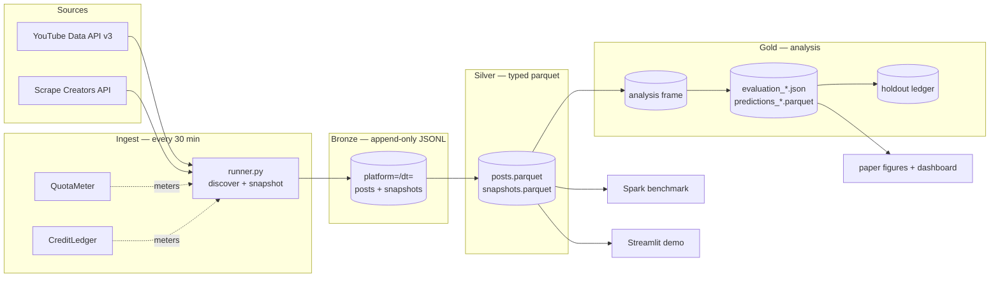

# Content Death Clock — Technical Report

## A quota-constrained longitudinal collection pipeline, and a measured pandas–Spark crossover

**Amogha V Prasad · S Anannya · Sanidhya Tiwari · Shubhang Srinivas Varda**
RV University, Bengaluru — 7th Semester, Big Data Analytics

> **Status, as of 2026-10-18. Final.** Both study cohorts are fully collected and analysed:
> Cohort A closed 2026-09-16 and Cohort B, the sealed holdout, closed 2026-10-04 and was
> evaluated once on 2026-10-18. The collector keeps running, but nothing it gathers after
> 2026-10-04 enters an analysis. Every figure below is measured from the repository and
> names the command or file it comes from. The scalability benchmark was re-run on the
> final dataset on 2026-10-18 (§7).

---

## 1. What the system has to do, and why that is hard

The analytical goal is stated in the companion Research Methodology paper: predict when a
social media post stops receiving attention. The engineering consequence of that goal is the
whole of this report.

**Decay labels cannot be back-filled.** A post's first hour happens once. If the collector is
not running at t+1h, that observation does not exist and no amount of later effort recovers
it. Every design decision below follows from that single irreversibility.

Four constraints shape the system:

| Constraint | Consequence |
|---|---|
| **Wall-clock bound** — labels require weeks of repeated observation | Collection must be live before anything else is built, and must survive unattended |
| **Hard API quota** — YouTube Data API v3 gives 10,000 units/day | Cost per tracked post must be engineered, not discovered |
| **Non-renewable credits** — Instagram scraping costs money per call | Spending must be metered locally; the API returns no balance |
| **Append-only evidence** — raw observations are the study's primary data | Writes must be idempotent and must never rewrite history |

This is not a large dataset by volume, and the report does not pretend otherwise (§8). It is
a *long* dataset: the difficulty is temporal completeness and cost per observation, not
terabytes.

**What the data was used for.** The pipeline fed two cohorts: 686 analysable videos (Cohort A)
and 831 more in a sealed holdout (Cohort B). On both, a random survival forest ranked which of
two videos would stop getting attention first about 60% of the time (C-index 0.616 and
0.600), against 50% for guessing, but named the time no better than the cohort's median
lifetime. The RM paper reports and interprets those results; this report is about the system
that made them possible.

---

## 2. Architecture

A medallion pipeline. Each layer has exactly one job and can be rebuilt from the layer below.



### 2.1 Bronze — raw, append-only, partitioned

`data/bronze/platform={youtube,instagram}/dt=YYYY-MM-DD/{posts,snapshots}-<cycle>.jsonl`

Bronze is the study's evidence. It is never rewritten, never cleaned in place, and never
back-corrected. Every downstream layer is a pure function of it, so any transform decision can
be revisited without re-collecting. It is committed to the public repository by the collector
itself, one commit per run, so the commit history doubles as a timestamped record that
collection actually ran.

### 2.2 Silver — typed, deduplicated, cross-platform

`transform/silver.py` normalises both platforms into one schema and resolves the substantive
per-platform difference explicitly: a `primary_metric` / `primary_value` pair, views for
YouTube and likes for Instagram, driven from config rather than hard-coded. Downstream code
reads `primary_value` and never needs to know which platform a row came from, while the choice
stays visible in the data so the paper can report it.

Three invariants enforced here:

1. **Deduplication.** Enforced again in silver even though the bronze writer already dedupes.
   A duplicated snapshot silently halves a velocity, so the guarantee is worth having twice.
2. **Ages recomputed from timestamps**, not trusted from what the collector wrote. If a clock
   or a publish time was ever corrected, the recomputed value is the honest one — and the two
   disagreeing is itself worth knowing about.
3. **Zero is not missing.** A hidden count arrives as null and stays null.

### 2.3 Gold — features and evaluation

`transform/features.py` builds the model matrix under a hard leakage boundary (§6).
`eval/report.py` runs the pre-registered evaluation and writes a machine-readable result,
the out-of-fold predictions, and, for the holdout only, an entry in a committed ledger.
`eval/figures.py` draws the paper's figures from those files and nothing else, so a figure can
never show a number the tables do not.

---

## 3. The quota cost model

This is the section that makes the system a *big data* artefact rather than a script: the cost
of tracking a post was derived analytically, then measured against the derivation.

### 3.1 Derivation

Two endpoints matter, and they differ by two orders of magnitude in price:

| Call | Cost | Returns |
|---|---|---|
| `playlistItems.list` | **1 unit** | up to 50 recent uploads for one channel |
| `search.list` | **100 units** | search results |
| `videos.list` | **1 unit** | statistics for up to **50 video IDs** |

Discovery is done through each channel's **uploads playlist**, never through search. Using
`search.list` for discovery across 63 channels would cost 6,300 units per cycle and exhaust
the entire daily budget in under two cycles.

For a cycle with `C` frame channels and `V` posts due for re-measurement:

> **cost(cycle) = C + ceil(V / 50) units**

The first term is fixed by the size of the sampling frame. The second is the only term that
grows with the panel — and it grows at **1/50 of a unit per tracked post**.

### 3.2 Measurement

Measured over the **1,132 cycle logs** that completed without a quota refusal, 2026-08-30 to
2026-10-18 (`data/bronze/_cycles/`; the logs keep one cycle per clock hour, §5.6, so they are
a sample of about half of all cycles, not the total):

| Quantity | Measured |
|---|---|
| Units per cycle | median **65**, mean 64.8, range 33–67 |
| Units on `playlistItems` | 71,300 (**97.2%** of all spend) |
| Units on `videos` | 2,046 (2.8%) |
| Posts discovered (logged cycles) | 1,211 |
| Snapshots taken (logged cycles) | 13,916 |
| Posts due per cycle | median 19, max 120 |
| Active panel at cycle start | median 664 posts, max 742 |

The prediction was `C + ceil(V/50)` = 63 + 1..3 = **64–66 units**. The measured median is 65,
across seven weeks and a panel that grew from zero to over 700 active posts. The model holds.

### 3.3 The headline cost result

The collector ran about 52 times a day (counted from the collector's own commits in the git
history). At 65 units a run:

> **≈ 3,400 units/day = 34% of the free 10,000-unit daily quota**, keeping a median of 664
> posts under observation across 63 channels.

Two consequences worth stating plainly:

- **Cost is dominated by frame size, not panel size.** 97.2% of quota goes to asking 63
  channels "anything new?" The marginal cost of one additional tracked post is **0.02 units
  per cycle** — the panel could grow roughly 50× before discovery stops dominating.
- **The system therefore scales sub-linearly in cost per tracked post.** Cost per tracked post
  per day is about 5 units at the measured panel size; at 5,000 tracked posts it would be
  about 0.7. This is the claim the BDA deliverable was built to support, and it is measured
  rather than asserted.

The cost model also turned out to be the instrument that exposed a security incident: when
the provider reported the daily quota exhausted while the meter said a third of it had been
used, the gap had to be someone else's spending (§5.5).

### 3.4 Instagram: metering an API with no balance endpoint

Scrape Creators returns **no balance header**, so spending is invisible unless counted
locally. `CreditLedger` maintains a per-key ledger under `data/bronze/_credits/`, keyed by a
**SHA-256 fingerprint prefix of the key, never the key itself** — which is why it is safe to
commit alongside the data.

The ledger enforces a hard local cap and fails over across keys. Across the whole Instagram
feasibility study, which ended 2026-09-05, **280 of the 300 credits** on three keys were spent
(100, 100 and 80), of which 102 were wasted during an 18-hour API fault before the cadence gate
was fixed (analysis plan, amendment of 2026-09-05). 20 credits remain.

---

## 4. Reliability engineering: the scheduler was measured, not trusted

### 4.1 The failure

Collection was originally scheduled with a GitHub Actions `cron`. GitHub does not guarantee
cron punctuality on free runners, and the documentation says so, but the size of the deviation
was the surprise:

- **Roughly one scheduled slot in three actually fired.** Mean gap between successful cycles:
  **3.03 hours** against a nominal 1 hour.
- One **7-hour overnight gap**.
- Consequence: **97.7% of posts lost their t+1h observation** — the single most valuable point
  on a decay curve, and the one that cannot ever be recovered.

The project's central irreversibility was being violated silently, by infrastructure, while
every workflow run showed green.

### 4.2 The fix

An **external scheduler** (cron-job.org) now triggers the workflow via `workflow_dispatch`
through a fine-grained personal access token scoped to a single repository with
Actions: read-and-write. The GitHub `cron` is retained as a fallback.

The `workflow_dispatch` entries in the run history are not manual runs; they are the external
scheduler firing.

**The fix helped, and an earlier version of this report overstated by how much.** We initially
recorded that t+1h capture went "from 2.1% to 100%". A later audit, measuring coverage strictly
— an observation counts for a mark only if it falls inside that mark's own tolerance window —
gave a very different picture, and the t+1h mark needed a second, unrelated fix (§5.3):

| Posts published | t+1h | t+3h | t+6h | t+12h |
|---|---:|---:|---:|---:|
| Before the scheduler fix | 13% | 84% | 33% | 31% |
| After the scheduler fix, before the t+1h fix | 45% | 97% | 93% | 92% |
| **After both fixes** (2026-09-01T20:45Z to 2026-10-04, n = 1,542) | **99.5%** | **98.6%** | **97.5%** | **97.0%** |

The first two rows are the audit of 2026-09-01 and are kept as measured. The last row is the
final measurement over every YouTube post published between the second fix and the Cohort B
close: once both faults were gone, the earliest and most valuable reading was being taken on
time for essentially every post.

### 4.3 The monitoring lesson: an alarm that cries wolf is worse than none

The first completeness monitor alarmed whenever snapshot capture fell below 80%. Real capture
sits naturally at 79–82%, because a post admitted late legitimately misses its earliest marks.
The alarm therefore flapped constantly, and a constantly-flapping alarm is one nobody reads.

It was rewritten to fire only on conditions that are unambiguously wrong: a collection
**outage** (no data for more than three hours, measured from the full history so an outage
still in progress cannot hide), or **collapse** (capture below 50% with at least 50 posts in
the panel). Normal jitter no longer alarms.

### 4.4 The monitoring lesson, part two: a metric that flatters is worse than none

The monitor credited a scheduled mark as covered by *any* observation up to six tolerance
widths later. For the t+1h mark that meant an observation taken at 3h counted as covering it.

So the monitor reported **96% coverage of a mark that was genuinely being hit 45% of the
time**, and the data-loss bug in §5.3 stayed invisible for days behind a green dashboard.

A late reading is real data, but it is not the measurement the schedule asked for, and for the
early marks it cannot substitute at all: velocity at 1h cannot be computed from an observation
taken at 3h. Coverage is now reported in two columns, on-time and late, and late credit can no
longer be claimed by an observation that falls inside the *next* mark's window.

| Metric (`python -m cdc.collect.monitor`) | Reported before the audit | Audit, 2026-09-02 | Final, 2026-10-18 (2,408 posts) |
|---|---:|---:|---:|
| Mean completeness | 90.9% | 76.9% | **90.4%** |
| On-time only | — | 68.0% | **89.5%** |

The final figures include three outages (7 hours from 2026-08-31T02, 14 hours from
2026-10-15T17 and 11 hours from 2026-10-17T20, the last two caused by the leak in §5.5) and the
336-hour mark that was never once observed (§5.4). That one mark alone caps any post older
than two weeks at 12 of 13 marks, or 92.3%.

The monitor had a third blind spot, found only on 2026-10-16: its per-mark table printed a row
for a mark only if at least one post had hit it. A mark that was missed by every post had no
row at all, so the most complete failure the schedule could suffer was the one the table could
not show.

**The general lesson, which belongs in the report because it cost us real data more than
once:** every monitoring failure here was a failure of *generosity* or of *absence*. An alarm
tuned to avoid false positives stopped reporting true ones; a coverage metric tuned to be
forgiving stopped measuring the thing it was named after; and a table of successes could not
show a measurement that never happened.

---

## 5. Correctness and security engineering

Each of these was found by tests, instrumentation or an audit against what *should* have
happened, rather than by inspection, and each produced plausible numbers while it was wrong.

### 5.1 The bronze writer overwrote instead of merging

`cycle_id` has **hour** granularity, so at a 30-minute cadence two cycles in the same clock
hour target the same filename. The writer opened that file for writing.

The second cycle of every hour was therefore erasing the first. Silently. For what would have
been three weeks.

**Fix.** The writer now reads the existing file, merges by dedupe key — `(post_id,
snapshot_ts)` for snapshots, `(post_id,)` for posts — and writes atomically via a temporary
file and `os.replace`. A regression test writes two batches under one cycle id and asserts both
survive.

### 5.2 Discovery discarded statistics it had already paid for

The discovery call returns live view counts alongside video metadata. The original code kept
the metadata and threw the statistics away, then waited for the next cycle to take a "first"
snapshot.

That discarded observation was the **earliest measurement of the post we would ever have**, at
**zero additional quota cost**.

**Fix.** Discovery now writes an `at_discovery` snapshot immediately, flagged as such so the
analysis can distinguish it. The snapshot step then skips posts already snapshotted this
cycle, so nothing is paid for twice.

### 5.3 The at-discovery snapshot was swallowing the t+1h mark

The most expensive bug in the project, and a direct consequence of fixing §5.2.

`Panel.due` decided whether a post was owed an observation by comparing a **count** of
snapshots taken against a **count** of scheduled marks passed. Discovery writes a snapshot the
moment a post is found — median 14 minutes after publication, well before the t+1h window
opens — so that snapshot made every post look as though it had already satisfied its first
mark.

Every post was therefore permanently one observation behind, and **the mark it lost was always
t+1h**: the earliest, most valuable and least recoverable point on a decay curve, and the basis
of every early-velocity feature in the study.

It was found by auditing coverage against *eligibility* rather than reading the monitor: for
posts published after the scheduler was repaired, t+3h ran at 97%, t+6h at 93% and t+12h at
92% — while t+1h sat at 45%. A uniform scheduling problem cannot produce that shape. Only the
first mark was affected, which pointed straight at the thing that happens once, at the start.

**Fix.** A snapshot counts toward the schedule only if it is old enough to fall inside the
first mark's tolerance window. Earlier observations are still stored — they remain the earliest
data we will ever have — they simply satisfy no mark. After the fix, t+1h ran at 99.5% (§4.2).

**How it hid for so long.** The offline integration test asserted that each post received
exactly 13 snapshots, matching the 13 scheduled marks. That assertion passed throughout,
because the post was receiving one discovery snapshot plus twelve scheduled ones. The test was
encoding the bug as the specification. It now asserts 13 *scheduled* marks plus the discovery
observation.

### 5.4 The last scheduled reading could never be taken

The schedule ends with a reading at 336 hours, fourteen days after publication. **No post in
the dataset has ever been observed past 241 hours.**

The cause is a boundary in the same function. `Panel.due` owes a post a mark only once its age
has *passed* that mark, but drops the post from the panel as soon as its age *exceeds*
`max_track_hours`, which is 336, the last mark itself. The 336-hour mark could therefore be met
only by a cycle landing at exactly 336.000 hours, and none ever did. The defect was present
from the first commit (2026-08-30) and was found on 2026-10-16, while checking whether a quota
outage had cost the holdout any observations.

**Effect.** Every post was in practice observed for 240 hours, ten days, not fourteen; and
because a death needs two consecutive slow intervals, the latest death the label can confirm is
at 168 hours. It applied identically to every post in both cohorts and depended on no outcome,
so it narrows what the study measures rather than biasing any comparison. It is recorded as an
amendment to the analysis plan and in the RM paper.

**Not fixed, deliberately.** Both cohorts were collected under the same instrument, and no
analysis uses posts published after the Cohort B close, so a fix now would buy no analysable
observation and would make the record harder to read. The fix, should the collector be reused,
is to keep a post in the panel until its age passes `max_track_hours` plus the tolerance.

### 5.5 The API key leaked through an error message

**What happened.** The YouTube key travels as a query parameter, and the `requests` library
puts the full request URL into the text of an `HTTPError`. On **2026-09-17T09:31Z** one
channel's uploads playlist returned a 404. The runner recorded the error text in the cycle
log, the cycle log was committed with the data, and this repository is public. From that
moment the live key sat in plain text in
`data/bronze/_cycles/2026-09-17T09.json` and `T10.json`.

**How it showed up.** Not as a security alert, but as a quota failure the cost model said was
impossible:

| Date | Provider refused us from | What our own meter showed |
|---|---|---|
| 2026-10-15 | 16:31Z, 9.5 hours into the quota day | 21 runs that day, about 1,400 units |
| 2026-10-17 | 20:31Z | 31 runs, about 2,000 units |
| 2026-10-18 | 09:31Z, 2.5 hours after the reset | 5 runs, about 300 units |

Each quota day starts at 07:00Z (midnight Pacific). The collector's measured cost (§3.2) could
not account for any of these, and the exhaustion was coming sooner each time, which is the
signature of a key being used by someone else. A search of the repository's history for the
key's fixed prefix found it in the two committed logs.

**Fix** (commit `dfd1e96`). Every message leaving `YouTubeClient` is now redacted, both the
`key=` parameter and the literal key, and raised without the original exception chained on,
because a chained traceback in the public Actions log would print the URL again. The runner
redacts a second time before it logs or records anything. Five tests rebuild the exact
2026-09-17 failure using a real `requests.Response`. A new key, restricted to the YouTube Data
API only, replaced the old one in the GitHub secret on 2026-10-18.

**Revoked, not rewritten.** The leaked key was deleted in the Google Cloud console on
2026-10-18, which ends the exposure: a revoked key is worthless. It remains in the repository's
history, and stays there, because rewriting a public history of more than 2,500 data commits,
which is the study's evidence, would do more harm than leaving a dead string in it.

**Effect on the study: none.** Every post in both cohorts had received its last observation by
2026-10-14. The outages cost only posts published after the Cohort B close, which no analysis
uses.

### 5.6 Known open defects

1. **Cycle logs overwrite within the hour.** `data/bronze/_cycles/<cycle_id>.json` shares the
   hour-granular id, so at a 30-minute cadence the second cycle log of each hour overwrites the
   first. Bronze data itself merges correctly (§5.1), but the number of cycle logs understates
   the number of cycles run, so daily cycle counts in this report come from the git history
   instead. Fix: append the minute to the log filename.
2. **No daily quota guard.** The runner refuses a cycle that would exceed 400 units
   (`max_quota_per_cycle`) but keeps no running total per quota day, so the first warning of the
   2026-10 exhaustion was the provider's refusal. Fix: track units per Pacific-time day and
   alarm when the provider's refusal arrives before the meter says the budget is spent.
3. **The 336-hour boundary** (§5.4), left as it is on purpose.

---

## 6. The leakage boundary

The most common fatal flaw in a project of this shape is training on information the model
would not have at prediction time. Three mechanisms guard against it, and all are tested.

**Temporal boundary.** Features are computed by a function that receives only observations at
or before the 7-hour landmark. `interpolate_at()` never extrapolates: outside the bracketing
observations it returns missing, rather than inventing a value.

**Creator boundary.** `GroupKFold` grouped by creator. Random k-fold would place the same
creator on both sides of the split and inflate every score.

**The test has teeth.** An assertion that grouped CV *passes* proves nothing unless a leaky
split *fails*. On a synthetic null cohort containing no signal at all:

| Split | C-index |
|---|---|
| Grouped by creator | **0.491** (chance, as it should be) |
| Deliberately leaky | **0.804** |

The first version of this test did not have that property — a deliberately leaky split scored
+0.023, inside noise — so it was strengthened until it could detect the failure it exists to
prevent.

**Holdout boundary.** Cohort B can be evaluated only with an explicit unlock flag, and every
evaluation is appended to a committed ledger with its timestamp, code commit, sample size and a
digest of the results. Its evaluation procedure was declared in writing two days before it was
opened, and it was run exactly once, on 2026-10-18, from the declared commit; the ledger at
`data/gold/holdout_evaluations.jsonl` holds that single entry. Cohort B is cross-validated
within itself rather than scored by a model trained on Cohort A, because 43 of its 51 channels
also appear in Cohort A and the creator boundary above would otherwise be broken.

---

## 7. Scalability: pandas against Spark, measured

### 7.1 Why a benchmark and not a volume claim

A few tens of thousands of real snapshot rows is not big data, and claiming otherwise invites
the obvious attack. Instead of inflating the dataset we **amplify it synthetically**, run the
*identical* workload under pandas and Spark, and measure where distribution starts to pay for
itself. An honest scaling curve is a stronger artefact than a padded row count.

### 7.2 The workload

The real one: a per-post windowed time series computation. For each post, order observations
by age, difference consecutive values, divide by elapsed time to get engagement velocity, then
aggregate per post. This is a **group-by plus an ordered window plus an aggregation** — the
shape that actually stresses a distributed engine. A row-wise map would parallelise trivially
and prove nothing.

### 7.3 Equivalence is verified, not assumed

Before any timing, both implementations run on the same input and their outputs are compared.
If they disagree the benchmark **aborts**. Timing two implementations that compute different
things is worthless, and it is an easy mistake to make when one is pandas and the other is
Spark SQL.

### 7.4 Results

Both runs on the Ubuntu GitHub Actions runner (`.github/workflows/benchmark.yml`), 4 cores,
Temurin JDK 17 pinned, median of 3 timed repeats. The equivalence check passed in both.

**Run 1, 2026-08-31** — base dataset 1,047 rows, factors 1× to 1000×:

| Rows | pandas | Spark `local[1]` | Spark `local[4]` |
|---:|---:|---:|---:|
| 1,047 | **0.007 s** | 0.271 s | 0.201 s |
| 10,470 | **0.015 s** | 0.197 s | 0.155 s |
| 104,700 | **0.114 s** | 0.188 s | 0.172 s |
| 1,047,000 | 1.740 s | 0.415 s | **0.318 s** |

**Run 2, 2026-10-18** — base dataset 30,229 rows (every YouTube and Instagram snapshot
collected), factors 1× to 100× (Actions run `39123036090`):

| Rows | pandas | Spark `local[1]` | Spark `local[4]` |
|---:|---:|---:|---:|
| 30,229 | **0.011 s** | 0.195 s | 0.151 s |
| 302,290 | **0.131 s** | 0.147 s | 0.135 s |
| 3,022,900 | 2.132 s | 0.361 s | **0.357 s** |

Reproduce with `gh workflow run benchmark.yml -f factors="1 10 100" -f repeats=3`, or from
the Actions tab; the timings come back as a downloadable artifact.

### 7.5 Interpretation

**The crossover lies between about 300,000 and 1,000,000 rows, and the two runs agree on
it.** In August pandas still won at 104,700 rows and lost at 1,047,000. In October, on a base
dataset 29 times larger, the two engines were level at 302,290 rows (0.131 s against 0.135 s)
and Spark was **6.0× faster** at 3,022,900. Two runs two months apart, on different base data,
place the crossover in the same band, which makes it a measurement rather than an accident of
one dataset.

- **Below the crossover, pandas wins by up to 30×.** Spark's cost there is almost entirely
  fixed: JVM startup, query planning, serialisation. At 1,047 rows Spark spends 0.2 s of
  overhead on 0.007 s of work, and its runtime barely moves across two orders of magnitude of
  data because it is measuring overhead, not computation.
- **Past it, the order inverts.** pandas grows faster than linearly as memory pressure and
  sort cost bite, while Spark finally does real work in parallel.
- **Four cores barely beat one.** `local[4]` was 1.3× faster than `local[1]` at a million rows
  in August, and made almost no difference at three million in October (0.357 s against
  0.361 s). Amdahl's law plus shuffle cost: the ordered window forces a partition-and-sort
  that does not parallelise for free, so most of Spark's win here comes from its execution
  engine rather than from the extra cores.

**The engineering conclusion, stated against our own tool choice:** for this study's actual
data volume, **pandas is the correct engine and Spark would be a mistake**. The Spark path
earns its place as the answer to "what happens at a thousand times the scale", which the
benchmark answers with a number rather than a hope. A system that knows where its own
crossover is, is better engineered than one that reaches for a cluster by reflex.

**What was not measured.** The October run stops at 100× (about 3 million rows) rather than
1000×. At 1000× of the final base, about 30 million rows, the benchmark's own setup step —
copying a pandas frame into Spark row by row through Python — would dominate the timing and
exhaust the runner's driver memory, so the number would describe the harness, not the
engines. Run 1 already measured the 1-million-row regime directly.

---

## 8. Honest positioning on "big data"

The dataset is **2,408 YouTube posts and 28,723 snapshots**, plus 396 Instagram posts and
1,506 snapshots: 3,222 bronze files, about 40 MB, written by 2,575 unattended collection runs
over 50 days (`python -m cdc.collect.monitor`; `git log`). That is small.

What makes this a big data systems problem is not volume but the other three Vs plus a fourth
that the textbooks under-emphasise:

- **Velocity** — the data arrives on an unforgiving schedule and cannot be requested again.
- **Variety** — two platforms with genuinely incommensurable primary metrics, reconciled
  explicitly rather than by coercion.
- **Veracity** — platform-reported counts that retract (108 repairs in Cohort A alone), hidden
  counts that must not be read as zero, and a bulk uploader that nearly destroyed the sample.
- **Cost** — a hard external quota that makes the cost per observation a first-class design
  variable, which is the constraint most real pipelines actually face, and which in this
  project also turned out to be the first sign of a security breach (§5.5).

The scalability benchmark is what connects the small real dataset to the large-scale claim,
and it does so by measurement rather than by assertion.

---

## 9. Serving: the demo and the dashboard

**Streamlit demo** (`src/cdc/app/`, `streamlit run src/cdc/app/main.py`). Pick any tracked post
and see its observed view curve, its velocity between readings as a share of its own peak, the
death threshold, and its status: died at a stated hour, or still alive. It deliberately does
**not** show a countdown for a post whose death has not been observed and for which no model
prediction exists; it says "no prediction available yet" instead. A demo that always shows a
confident number teaches its audience the wrong thing about the system.

**Interactive dashboard.** A web dashboard presents both deliverables for readers who will not
run code: a pipeline tab (volume per day, the outages, coverage by scheduled mark with the
missing 336-hour reading, the benchmark, and the incident log) and a findings tab (one video's
decay, survival curves and model scores switchable between the two cohorts, and the H2 test
across every analysis). Every figure on it is drawn from a data file exported from this
repository, and each file can be downloaded from the page.

**Paper figures.** `python -m cdc.eval.figures` regenerates the RM paper's five figures from
the gold artifacts.

---

## 10. Testing and CI

- **226 tests**, run on every push.
- Label functions tested against synthetic curves with analytically known death times.
- Idempotency test: the same cycle run twice must not change the silver row count.
- Leakage test with the discriminative power documented in §6.
- Benchmark equivalence check as a gate, not a report.
- **Credential redaction:** five tests rebuild the 2026-09-17 leak with a real
  `requests.Response` and assert the key appears nowhere in the resulting error, including the
  chained exception.
- `--dry-run` plans a full collection cycle and prints its exact quota cost **without spending
  a unit**, so a schedule change can be reviewed before it is paid for.
- **The temporal holdout is enforced in code.** Cohort B refuses to evaluate without an explicit
  unlock flag, refuses to run before every member has finished its observation window, refuses
  the post-hoc feature set, and appends every run to a committed ledger. Making a methodological
  commitment executable is cheaper than remembering it, and unlike a note in a document it
  cannot be quietly forgotten under deadline.

---

## 11. Repository map

```
config/settings.yaml            every experimental parameter, one file
config/channels.resolved.yaml   the frozen sampling frame, with measured subscriber counts
ANALYSIS_PLAN.md                pre-registered, frozen 2026-08-30, six dated amendments appended
src/cdc/collect/                youtube.py, instagram.py, runner.py, monitor.py
src/cdc/storage/bronze.py       idempotent merge-and-dedupe writer
src/cdc/transform/              silver.py, features.py (leakage boundary)
src/cdc/labels/death.py         the dependent variable
src/cdc/models/                 dataset.py, survival.py, baselines.py, synthetic.py
src/cdc/eval/                   validate.py, report.py (power guard), holdout.py, figures.py
src/cdc/bench/                  amplify.py, spark_bench.py
src/cdc/app/                    Streamlit demo
data/bronze/                    the raw evidence, committed by the collector
data/gold/holdout_evaluations.jsonl  the single Cohort B evaluation, committed
paper/rm/figures/               the RM paper's figures
.github/workflows/snapshot.yml  collection (externally triggered)
.github/workflows/benchmark.yml manual, Ubuntu, pinned JDK 17
```

## 12. Runbook

```bash
python -m cdc.collect.runner --dry-run
```

```bash
python -m cdc.collect.monitor
```

```bash
python -m cdc.transform.silver
```

```bash
python -m cdc.eval.report --platform youtube
```

```bash
python -m cdc.eval.report --platform youtube --outcome saturation
```

```bash
python -m cdc.eval.figures
```

```bash
python -m pytest
```

The Cohort B holdout (`--cohort B --unlock-holdout`) has been run, once, on 2026-10-18.
Running it again is possible, and would be recorded in the ledger as a second look at the
holdout that the paper would have to report.

---

## 13. What we would do differently

1. **Measure the scheduler on day one.** We built four days of pipeline on top of a cron that
   was firing one time in three. The cost of checking was ten minutes; the cost of not checking
   was nearly the dataset.
2. **Never let a credential into a URL, or a raw HTTP error into a log.** Keys belong in
   headers where the API allows it; where it does not, every message that leaves the client
   must be redacted. One 404 put a live key into a public repository for a month (§5.5).
3. **Make the cycle id minute-granular from the start** (§5.1, §5.6). One naming decision
   caused a silent data-loss bug and still causes a monitoring one.
4. **Measure coverage against eligibility, not against itself, and show every row.** Three of
   the defects above were invisible in a dashboard that compared the data only to itself, and a
   fourth was invisible because the table printed only marks that had been hit. The question
   that finds them is "how many posts were owed this observation, and how many have it?"
5. **Guard the budget per day as well as per run, and treat a mismatch with the provider as an
   incident.** When the provider said the quota was spent and our meter said a third, the
   discrepancy was the breach.
6. **Write the null-cohort test before the real one.** A test that cannot fail is not a test,
   and ours could not until it was rebuilt.
7. **Treat the earliest available observation as the most valuable one** and never discard a
   measurement already paid for (§5.2).
