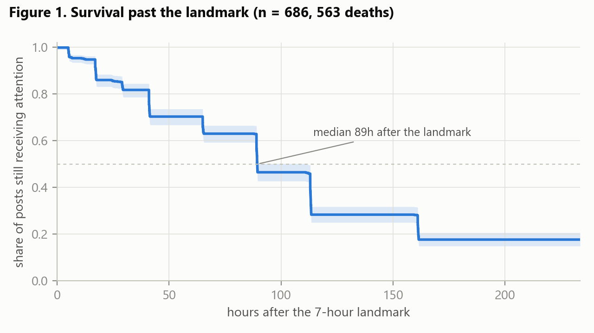
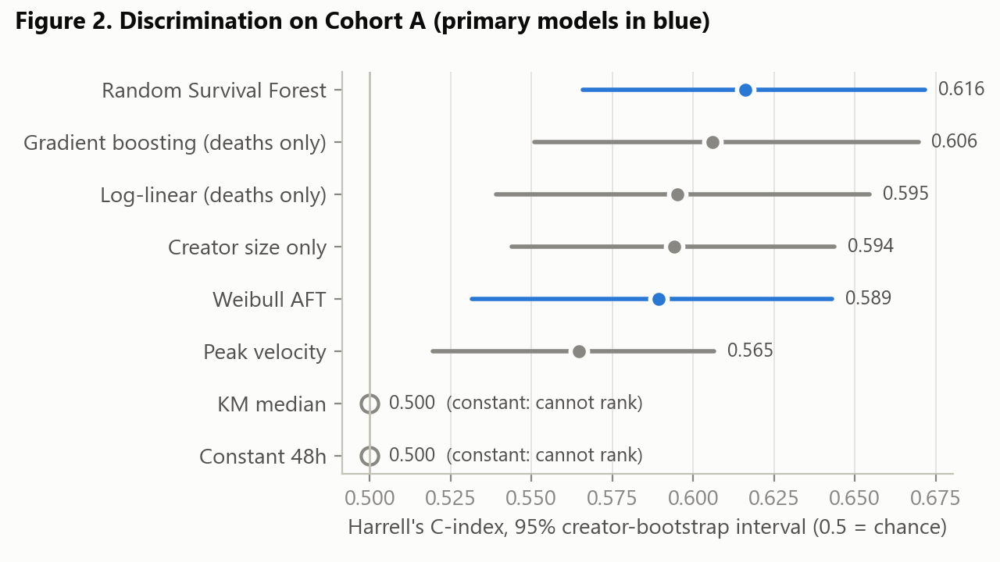
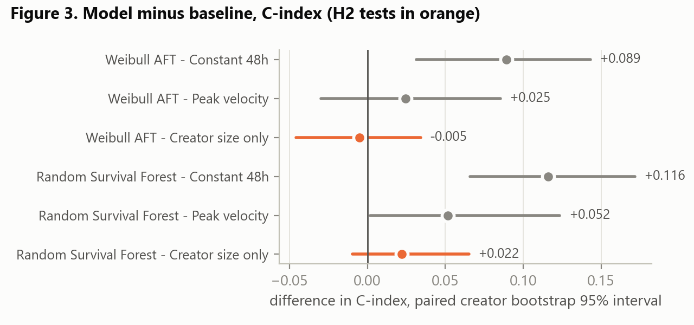
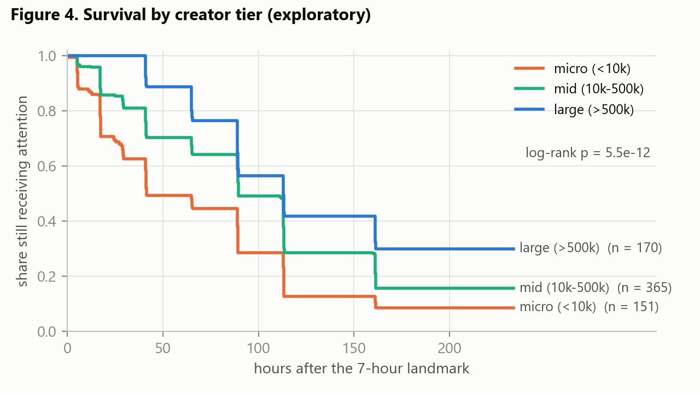
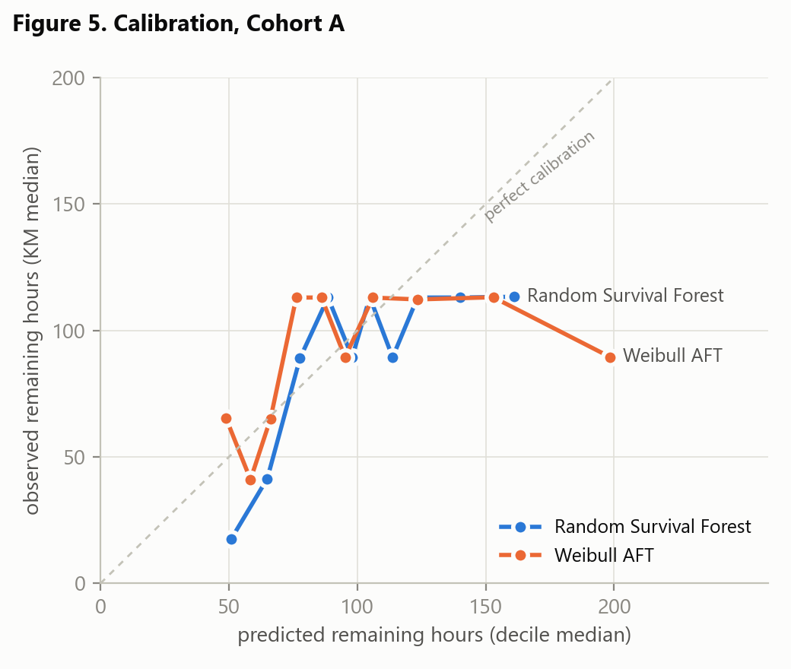

# Content Death Clock: Predicting Time-to-Attention-Death for YouTube Videos from First-Session Engagement Signals

**Amogha V Prasad · S Anannya · Sanidhya Tiwari · Shubhang Srinivas Varda**
RV University, Bengaluru — 7th Semester, Research Methodology

> **Draft status, as of 2026-10-18.** Method (§3) follows `ANALYSIS_PLAN.md`, frozen
> 2026-08-30, plus the six dated amendments summarised in Appendix A. **All results are
> final.** The Cohort A results in §4 come from the matured analysis of 2026-10-16 (563
> deaths), replacing the provisional figures of 2026-09-20 (498 deaths); maturation changed
> one conclusion, not just digits (§4.4). **Cohort B, the sealed holdout, was evaluated once
> on 2026-10-18, exactly as declared (§4.7).** It replicated the models' modest
> discrimination and did *not* replicate the dominance of creator size, so §5 and §8 have
> been revised where the Cohort A reading no longer holds.

---

## Abstract

**Background.** Research on social media content overwhelmingly predicts *growth* — which
posts will go viral, how large a cascade will become, what a video's view count will be at
some future horizon. The complementary question is barely asked: given that attention is
finite and decays, *when does a post stop receiving meaningful attention?*

**Objective.** We test whether the time at which a post's engagement velocity collapses can
be predicted from signals observable in its first seven hours, and specifically whether
early *dynamics* carry information beyond the creator's audience size.

**Method.** Prospective observational panel. A pre-registered, frozen analysis plan
specifies hypotheses, exclusion rules, models, baselines and inference before any outcome
data was examined. Sixty-three public YouTube channels, stratified by subscriber tier and
content category, were tracked by an automated collector every 30 minutes, with each post
re-measured at scheduled ages from 1 to 240 hours. Attention death is defined per post as the first
time engagement velocity falls below 5% of that post's own peak velocity and remains below
for two consecutive intervals; posts that never reach it are right-censored, not discarded.
Predictions are made at a **landmark of t = 7h** and the outcome is the time *remaining*
from the landmark. Models are Weibull AFT and Random Survival Forest, evaluated with
`GroupKFold` grouped by creator against four baselines including a creator-size-only model.

**Results.** Cohort A comprises 686 posts from 47 creators, 563 of them observed to reach
attention death (17.9% censored); median time to death from the landmark is 89.4h
(95% CI 89.2–111.5). Both primary models discriminate better than chance — Random Survival
Forest C-index 0.616 (95% CI 0.566–0.672), Weibull AFT 0.589 (0.531–0.643) — so H1 is
supported on discrimination. It is not supported on absolute error: both models now beat
the folk-belief "48 hours" baseline (paired Wilcoxon p < 0.001 and p = 0.005), but neither
beats the better naive baseline, the Kaplan–Meier median, which attains the lowest error of
any method tested (forest p = 0.085, not significant; Weibull AFT significantly worse,
p = 0.004). **H2 is not supported on any pre-specified test.** A creator-size-only baseline
scores C-index 0.594. The forest exceeds it by +0.022 (paired creator bootstrap 95% CI
−0.009 to +0.065; Wilcoxon p = 0.083), and the Weibull AFT scores *below* it (−0.005,
p = 0.440). Of five pre-registered sensitivity analyses, one — a stricter 2% death threshold,
forest only — would satisfy H2; the other four, including a mechanically different outcome
definition, do not. In the sealed temporal holdout (Cohort B: 831 posts, 655 deaths, 50
creators), evaluated once as declared in advance, the forest again discriminated (C-index
0.600, 95% CI 0.555–0.648) and again failed to beat the Kaplan–Meier median on absolute
error. H2 was again not supported under the pre-declared rule, but for a different reason:
the forest beat creator size on discrimination (+0.083, 95% CI +0.033 to +0.134) but not on
absolute error (p = 0.69), and creator size alone did no better than chance (0.517).

**Conclusion.** Time to attention death is predictable from first-session signals to a
small, measurable and replicable degree (C-index about 0.60 in both cohorts), but absolute
predictions are imprecise by roughly a factor of two, and no method beats the cohort's median
lifetime on them. Whether early engagement *dynamics* add anything beyond creator size is not
settled: in the main sample they did not, and in the holdout they did on ranking but not on
error. Cohort A's apparent dominance of creator size did not replicate. We report all of this
as the result, as pre-registered on 2026-08-30, rather than as a specification to be
improved upon.

**Keywords:** attention decay, survival analysis, right-censoring, landmark analysis,
social media, pre-registration, YouTube

---

## 1. Introduction

Attention is the scarce resource in online media, and it is spent, not stored. A post
accumulates engagement quickly, plateaus, and then stops mattering — but the literature has
concentrated almost entirely on the first half of that arc. Popularity prediction, cascade
prediction and virality detection all ask a growth question: *how big will this get?* The
decay half of the curve is treated as a nuisance to be modelled away rather than as the
quantity of interest.

We invert the question. Given a post and its first few hours of behaviour, **how long until
its attention dies?**

The inversion is not cosmetic; it changes what has to be measured and how the problem must
be posed statistically.

1. **The outcome is a time, not a count.** "How many views at 30 days" is a regression
   target. "When does velocity collapse" is a *duration*, and durations observed inside a
   finite window are systematically incomplete — some posts have not died yet when
   observation stops. Discarding them biases every estimate toward short-lived content,
   which is exactly the wrong direction. This makes survival analysis with right-censoring
   the correct frame rather than a stylistic preference.
2. **The outcome must be scale-free.** A channel with twenty million subscribers and a
   channel with two thousand differ by four orders of magnitude in raw velocity. An
   absolute threshold ("fewer than ten views per hour") would measure channel size, not
   decay. We therefore normalise each post against **its own** peak velocity, so a large
   video and a small video that decay identically receive identical labels.
3. **The prediction must be made while the post is still alive.** If a post dies at 3.1
   hours and its features are built from its first 6 hours, the "prediction" is a
   restatement of the observations that defined the outcome. We found empirically that this
   affected 53% of the deaths in our first analysis, and adopted a landmark design in
   response (§3.5, Appendix A).

### 1.1 Why this is worth predicting

A decay estimate is directly actionable in ways a popularity estimate is not. It tells a
creator when a post has stopped repaying promotion; it tells a platform when a piece of
content should leave a recommendation surface; it tells an advertiser when incremental spend
against a placement stops buying incremental attention. All three are decisions about *when
to stop*, and none of them is answered by a forecast of eventual total views.

### 1.2 Contributions

- **An operational, per-post-normalised definition of attention death** that is invariant to
  creator scale, computed on actually-observed timestamps rather than an assumed schedule,
  and paired with a second, mechanistically different robustness label (time to 90% of a
  fitted saturation asymptote) so the conclusions can be checked against a definition that
  does not share the first one's failure modes.
- **A prospectively collected, pre-registered panel.** The analysis plan was committed to
  version control on 2026-08-30, when the dataset contained 179 posts, **zero** computed
  death labels and zero fitted models. Six subsequent deviations are logged as dated
  amendments with stated reasons. The first four were made before any result existed;
  the last two came after the Cohort A results had been seen, and each says so and records
  what it was and was not allowed to change.
- **A landmark survival formulation** that makes the prediction task non-circular, together
  with the measurement that forced it.
- **Baselines chosen to be hard.** Beating "everything dies at 48 hours" proves nothing. Our
  second confirmatory hypothesis is stated against a **creator-size-only** model, so the
  claim under test is that early dynamics add information beyond knowing who posted.
- **A negative-result-tolerant reporting commitment** (§3.9) made in advance.

---

## 2. Related work and positioning

### 2.1 Popularity prediction from early signals

The foundational result is that early views predict later views remarkably well on a log
scale. Szabo and Huberman (2010) showed that the logarithm of a video's views at an early
time is strongly linearly related to its logarithm at a later time, which set the template
for the field: regress a future count on an early count. Pinto, Almeida and Gonçalves (2013)
improved on this by using the *shape* of the early view series rather than a single scalar.
Figueiredo and colleagues' TrendLearner classified content by its popularity *trend* — the
qualitative form of the curve — before predicting magnitude.

All of these predict a **count at a horizon**. None predicts a **time**.

### 2.2 Cascade prediction

Cheng, Adamic, Dow, Kleinberg and Leskovec (2014) reframed cascade prediction as a well-posed
binary problem ("will this cascade double in size?") and showed that temporal features
dominate content features. More recent deep-learning work on cascades — hierarchical and
graph-temporal architectures such as HierCas — continues in that direction with far greater
model capacity. The unit of analysis there is a diffusion structure over a social graph, and
the target remains growth.

Our unit of analysis is a single post's own engagement time series, which is what is
observable through public platform APIs for the overwhelming majority of content, and our
target is its cessation.

### 2.3 Collective attention and decay

Wu and Huberman (2007) established that collective attention to novel items decays, and
modelled it with a stretched-exponential form. This is the closest ancestor of our question,
but it is a *descriptive*, population-level model of how attention fades in aggregate. It
does not produce a per-item, ahead-of-time prediction of when a specific item's attention
will end, and it is not evaluated as a predictive task.

### 2.4 Survival methods applied to content

**We must be careful not to overclaim here.** Censoring-aware modelling of online content
lifetime is *not* unprecedented. Lee, Moon and Salamatian (2012) applied a Cox proportional
hazards model to the popularity dynamics of online content, treating item lifetime as a
survival outcome with explanatory covariates. That work is the nearest methodological
precedent to ours and is cited as such.

What we add relative to it: (i) an outcome defined by *velocity collapse normalised to the
post's own peak*, rather than by thread inactivity or a fixed absolute threshold; (ii) a
**landmark** formulation that guarantees the subject is at risk at the moment of prediction;
(iii) pre-registration with a frozen plan and dated amendments; and (iv) a creator-size-only
baseline as the primary comparator, which turns the study into a test of whether dynamics
add information rather than a demonstration that a model fits.

### 2.5 Positioning summary

| Work | Target | Outcome type | Censoring | Prediction time |
|---|---|---|---|---|
| Szabo & Huberman (2010) | Views at horizon | Count | Not handled | Fixed early time |
| Pinto et al. (2013) | Views at horizon | Count | Not handled | Fixed early time |
| TrendLearner (Figueiredo et al.) | Popularity trend class + magnitude | Class / count | Not handled | Early window |
| Cheng et al. (2014) | Cascade doubling | Binary | N/A | Cascade size k |
| HierCas and successors | Cascade size | Count | Not handled | Observation window |
| Wu & Huberman (2007) | Aggregate attention decay | Descriptive fit | N/A | Retrospective |
| Lee, Moon & Salamatian (2012) | Content lifetime | **Duration (Cox PH)** | **Handled** | Covariates at entry |
| **This work** | **Time to velocity collapse** | **Duration (AFT / RSF)** | **Handled** | **Landmark t = 7h** |

> **Citation verification required before submission.** Full bibliographic details for
> TrendLearner, HierCas and SMTPD must be checked against the source PDFs — in particular
> HierCas's venue and year, and SMTPD's sampling grid density, which determines whether that
> dataset could in principle support a decay label at all. Do not submit with these
> unverified.

---

## 3. Method

### 3.1 Design

Observational, prospective panel. Non-experimental: nothing is manipulated, no causal claim
is made, and the language throughout is predictive rather than causal.

### 3.2 Sampling frame

The frame is **63 public YouTube channels**, recorded in `config/channels.resolved.yaml`
with their subscriber counts as measured at frame-resolution time (2026-08-30T17:21 UTC),
stratified by subscriber tier and content category:

| Tier | Definition | Channels |
|---|---|---|
| micro | < 10,000 subscribers | 16 |
| mid | 10,000 – 500,000 | 17 |
| large | > 500,000 | 30 |
| **Total** | | **63** across 8 content categories |

**How the frame was built, and why it was rebuilt.** An initial convenience sample of
channels the authors follow produced 30 large / 2 mid / 1 micro. That distribution cannot
support H3 and would have made any claim about creator size vacuous. The frame was therefore
rebuilt by API search over a **committed query list** (`config/discovery_queries.yaml`): for
each query we searched *recent videos ordered by date*, resolved the channels behind them,
and admitted those falling in the under-represented tiers with an upload rate of at least
one per week.

Recent-video search was used rather than channel search deliberately. Channel search ranks
by relevance, which is a proxy for popularity, and therefore structurally cannot surface
sub-10,000-subscriber channels — precisely the stratum we lacked.

**The sampling claim, stated plainly.** This is **not** a random sample of YouTube. It is the
set of channels reachable by a fixed, version-controlled query list, filtered by size and
upload frequency. We do not claim generalisation beyond that frame. Because the queries are
committed, the frame is reproducible by a third party — a weaker claim than random sampling
and a considerably stronger one than an unrecorded convenience sample.

**Known frame biases**, stated in advance:

- the query list leans toward Indian and long-tail creators;
- channels uploading less than weekly are excluded by construction, so the frame
  over-represents frequent uploaders;
- micro-tier picks span 1,240–7,250 subscribers and mid-tier 10,800–373,000, so neither tier
  covers its full nominal range.

### 3.3 Data collection instrument

An automated collector runs every 30 minutes. Each cycle: (i) discovers posts published by
frame channels within the last `discovery_lookback_hours` = 6h, (ii) admits them subject to
the exclusion rules in §3.6, and (iii) re-measures every admitted post whose age has crossed
one of thirteen scheduled marks.

**Snapshot schedule (hours after publication):** 1, 3, 6, 12, 24, 36, 48, 72, 96, 120, 168,
240, 336. Tolerance 0.75h.

**The 336-hour mark was never observed.** A scheduling defect present since the first
commit meant a post became due for a mark only once its age had passed it, but left the
panel the moment its age exceeded 336 hours — the last mark itself — so that mark could be
met only by a cycle landing at exactly 336.000 hours. None did: no post in the dataset has
an observation older than 241 hours. The defect was found on 2026-10-16 and is recorded in
Amendment 6. Its consequence is that **the effective observation window is 240 hours (ten
days)**, and because death requires two consecutive sub-threshold intervals, the latest
death that can be confirmed is at the 168-hour observation. It applies identically to
every post and depends on no outcome, so it narrows the estimand to death within the first
week rather than biasing any comparison. The collection monitor missed it because its
per-mark coverage table listed only marks with at least one hit.

Three properties of the instrument matter for validity and are engineered rather than
assumed:

- **Ages come from observed timestamps.** A snapshot that arrives late is recorded as late.
  No velocity in this study is computed against an assumed grid.
- **Zero is not missing.** A metric the creator has hidden arrives as null and stays null.
  Coercing it to 0 would read as a genuine observation of no engagement, which the death
  label would score as instant death.
- **Writes are idempotent.** Records are keyed on `(post_id, snapshot_ts)` and merged, so a
  re-run cannot duplicate an observation. A duplicated snapshot silently halves a velocity.

The scheduler itself was measured rather than trusted; see §3.10 and the technical report.

### 3.4 Measures

#### Dependent variable — attention death

`t_death` is the first time at which engagement velocity falls below **5% of that post's own
peak velocity** and remains below for **2 consecutive intervals**. Velocity between
consecutive observations *i−1* and *i* is

> v_i = (C_i − C_(i−1)) / (a_i − a_(i−1))

where C is the cumulative primary metric and a is age in hours, both as actually observed. A
post that never satisfies the condition by its last observation is **right-censored at that
observation**, not dropped.

Cumulative counts occasionally decrease (platforms retract inflated views). Such
non-monotonic points are clamped, and **the number of repairs is counted and reported**
rather than silently absorbed.

#### The primary metric differs by platform, and this is substantive

YouTube uses **views**; Instagram uses **likes**. Instagram reports no view count at all for
image posts, so views cannot serve there. Likes saturate faster than views, which means
**death times are not comparable across the two platforms**. Per-platform results are
reported separately and are never pooled.

#### Robustness dependent variable

`t_saturation` — time to reach 90% of the asymptote A from a fitted C(t) = A(1 − e^(−kt)).
Reported alongside the primary label. Systematic disagreement between the two is a finding to
report, not a problem to conceal.

#### Independent variables — hard constraint: nothing observed after the landmark

The plan (section 5) lists: early value and velocity at 1h, 3h and 6h; log growth ratios
between consecutive snapshots; acceleration; video duration; title length; tag count;
publish hour and weekday; content category; **creator subscriber count**; creator
historical median velocity.

**What the models actually used is eleven of these**, fixed in the feature whitelist on
2026-08-31, before any death label existed: value at 1h, 3h and 6h (log); velocity to 6h;
log growth 1→3h and 3→6h; acceleration in ratio form (velocity over 3–6h divided by
velocity over 1–3h); log subscriber count; log duration; publish hour; title length. Five
listed variables never entered any model: tag count, publish weekday, content category,
creator historical median velocity, and acceleration as a raw difference. **This deviation
was not declared at the time and was found only on 2026-10-16, after the results.**
Amendment 6 keeps the eleven as the confirmatory specification — they are what was fixed
before outcomes were seen — and confines the fuller list to a labelled exploratory analysis
(§4.9) that is barred from Cohort B.

The leakage boundary is enforced in code, not by discipline: features are computed by a
function that receives only observations at or before the cutoff, and a test asserts that a
deliberately leaky split scores differently from a grouped one on pure noise (§3.10).

One detail worth stating because it is easy to get wrong: log growth ratios are computed
**without epsilon smoothing**. Adding a constant to the denominator distorts small quantities
far more than large ones, which would have biased the micro tier specifically and
contaminated H3. Where the baseline is zero the feature is missing, which is the honest
encoding.

### 3.5 Landmark design

Predictions are made at a **landmark of t = 7 hours**. A post is eligible only if it was
**observed and still alive** at the landmark, and the outcome modelled is the time
**remaining** from the landmark to attention death. Both the landmarked outcome and the raw
time-from-publication are retained in the analysis frame, so a sensitivity analysis requires
no re-derivation.

**Why.** With the outcome measured from publication, 53% of observed deaths fell inside the
6-hour feature window. A post that dies at 3.1h has its death determined by the very
observations its features are built from; predicting it is circular. Landmarking is the
standard survival remedy — a subject must be at risk at the moment the prediction is made.

**Why 7 hours and not 6.** The collector runs every 30 minutes, so the nominal 6-hour
measurement lands at a median age of 6.08h. A strict 6.00h cutoff discarded it for 72 of 86
posts, which is why every 6-hour-derived feature was 0% available in the first run. The
snapshot schedule contains nothing between 6h and 12h, so **any** observation at or before 7h
is one of the scheduled 1/3/6-hour measurements arriving slightly late. Usable feature
columns went from 4 to 8.

This is Amendment 2 (Appendix A), made when the outcome data contained seven observed deaths,
with no model selection performed and no result interpreted.

### 3.6 Exclusions

All exclusions are pre-specified, applied in one place, and **counted**. The attrition table
in §4.1 is generated directly by the analysis code.

| Rule | Reason code |
|---|---|
| Fewer than 4 usable inter-snapshot intervals | `insufficient_observations` |
| Never achieved positive velocity | `no_positive_velocity` |
| Creator has hidden like/view counts | `counts_hidden` |
| Died at or before the landmark | `died before the landmark` |
| Not yet observed at the landmark | `not yet observed at the landmark` |
| Beyond 5 posts from one creator on one UTC day (YouTube only) | `creator_daily_cap` |
| Deleted or made private during observation | recorded as **censored**, not excluded |

The creator daily cap is Amendment 1 (Appendix A). It exists because one channel published
**100 videos within 25 seconds** and came to supply 59% of the YouTube panel, at a median of
4 views against 1,152 for every other post. Those are not 100 independent observations — one
creator, one moment, one action.

### 3.7 Models and baselines

**Models.** Weibull accelerated failure time and Random Survival Forest (primary, both
censoring-aware); log-time linear regression and gradient boosting as comparators on the
uncensored subset. The two primary models are chosen to fail differently: AFT buys
interpretable coefficients at the price of a rigid parametric shape, the forest buys
flexibility and interactions at the price of interpretability.

**How the forest's prediction is summarised, and one consequence for the metrics.** A
forest predicts a survival *curve* per post, but the evaluation requires a scalar time. The
conventional summary — the median, i.e. where the curve crosses 0.5 — was undefined for most
of the sample when this choice was fixed (the 2026-09-01 dress rehearsal, 88% censored),
because most predicted curves never reached 0.5 inside the observation window. We therefore
summarise by **restricted mean survival time**: the area under the predicted curve up to
the last time observed in the training fold. At maturity Cohort A is only 18% censored, so
that original reason has largely lapsed; RMST is retained because it is the summary that was
fixed before any result was seen, and changing it now would be a choice made with the
answer in view.

RMST is always defined and orders posts correctly, so the C-index — the plan's primary
metric — is unaffected. But RMST is *restricted*: it is truncated at the training horizon
and so systematically under-states long lifetimes. **The forest's MAE is therefore not
directly comparable with the AFT model's, which extrapolates freely, and the paper reports
the two MAEs with that caveat attached rather than ranking them against each other.** We
could remove the truncation by fitting a tail beyond the horizon; we deliberately do not,
because extrapolating past the data here would contradict the no-extrapolation rule the
feature layer already enforces (§3.4).

**Baselines, all four reported:**

1. **Constant 48h** — "all content dies at two days."
2. **Training-set median lifetime** (Kaplan–Meier median).
3. **Creator-size-only** — subscriber count alone.
4. **Peak-velocity heuristic** — extrapolate from the largest observed velocity.

Baselines 3 and 4 are the ones that matter. Baseline 3 is what H2 is defined against.

### 3.8 Hypotheses, validation and inference

**H1 (confirmatory).** A model using features observed at t ≤ 7h predicts
time-to-attention-death more accurately than the best naive baseline (1 or 2).
*H1₀*: model ≤ best naive baseline. *H1₁*: model > best naive baseline.

**H2 (confirmatory — the one that matters).** Early engagement dynamics carry predictive
information beyond creator size: the model beats the creator-size-only baseline (3).

**H3 (exploratory, explicitly not confirmatory).** Time-to-death differs across creator-size
strata and content categories.

**Validation.** `GroupKFold(n_splits=5)` **grouped by creator**. Random k-fold would place
the same creator in train and test, leaking creator identity and inflating every score. This
is pre-specified precisely so it cannot be quietly relaxed later.

**Temporal holdout.** Posts published on or after 2026-09-16T00:00:00Z, and before the
close date 2026-10-04T00:00:00Z (Amendment 5), form **Cohort B** and are evaluated **exactly
once**, after all model selection is complete. The opening instant was fixed in
`settings.yaml` on 2026-08-30, before any outcome data was examined.

**What the holdout tests.** Cohort B is evaluated by running the registered procedure on it
unchanged — creator-grouped five-fold cross-validation *within* Cohort B — rather than by
scoring a model trained on Cohort A. The reason is the creator boundary: 43 of Cohort B's 51
channels also published in Cohort A, so a model trained on A and scored on B would have seen
almost every test creator in training, which is exactly the leakage the grouping rule
exists to prevent. The holdout therefore asks whether the Cohort A result **replicates on an
independent, later sample of posts**. It does not measure how one frozen model performs
going forward in time. The full specification, command and reading rule were declared on
2026-10-16, before the holdout was opened (Amendment 6).

**The "exactly once" commitment is enforced, not merely stated.** A holdout that can be
inspected casually stops being one: each look leaks into the choices made next, and after
several looks it has quietly become a second validation set. Cohort B therefore cannot be
evaluated by the ordinary command — it requires an explicit unlock flag, and every evaluation
is appended to a committed ledger recording the timestamp, the git commit, the sample size and
a digest of the results. A repeat evaluation prints a warning naming the date of the first.

The ledger is a record, not a lock; anyone determined can run it twice. That is the intent. The
purpose is to make a second look **visible**, including to ourselves, which is the same
reasoning that motivates pre-registration in the first place. If Cohort B is evaluated more
than once, the paper reports every evaluation, not the preferred one.

**Metrics.** Harrell's C-index (primary, censoring-aware); MAE and RMSE on log₁₀
time-to-death on the uncensored subset; a calibration plot of predicted against observed.

**Inference.** Paired Wilcoxon signed-rank test on per-post absolute errors, model against
each baseline. Bootstrap confidence intervals with 2,000 resamples, **resampled by creator**
rather than by post, because posts within a creator are not independent. The interval on a
*difference* between a model and a baseline is computed on the same creator draws for both,
so it is a genuinely paired interval rather than two separate intervals compared by eye.
α = 0.05. Effect sizes are reported alongside p-values, and a p-value alone will not be
treated as a result.

**Reading rule for H2.** H2 counts as supported only when a primary model beats the
creator-size-only baseline on **both** pre-specified tests: the paired Wilcoxon at α = 0.05,
and a paired bootstrap interval on ΔC-index that excludes zero. This is how the provisional
Cohort A analysis was read on 2026-09-20, when one test passed and the other did not, and it
was written down for Cohort B before the holdout was opened (Amendment 6). Holm-adjusted
p-values across the two primary models are reported alongside.

**Multiplicity.** H1 and H2 are the only confirmatory tests. Everything else is labelled
exploratory in this paper.

**Power.** The evaluation harness refuses to interpret a run with fewer than 50 observed
deaths or fewer than 10 creators, and prints sample size, death count and creator count
*before* any metric. The threshold was set in advance and is deliberately generous: even at
50 deaths a C-index is unstable.

### 3.9 Pre-registration, and what we will report regardless of outcome

`ANALYSIS_PLAN.md` was committed on **2026-08-30**, when the repository contained 179
collected posts, **0 computed death labels**, 0 fitted models and 0 examined results. That
state is recorded inside the plan itself, so the claim is auditable rather than asserted.

Committed in advance:

- **If the model does not beat the baselines, that is the reported result.** A negative
  finding honestly reported with a power discussion is a legitimate outcome. Searching for a
  specification that wins is not.
- Censoring rate, attrition by reason code, collection completeness and outages, and the
  count of monotonicity repairs are all reported whatever they say.
- Every deviation from the plan is reported with its reason and its date.

### 3.10 Reproducibility and instrument validation

All code, configuration, the frozen plan, the sampling frame and the raw collected data are
in a public repository. Analysis parameters live in a single `settings.yaml`, so the plan can
reference exact values rather than describing them.

Two instrument checks are worth reporting in a methods paper, because both found real faults:

- **A leakage test with teeth.** An assertion that grouped cross-validation *passes* is not
  evidence of anything unless a leaky split *fails*. On a synthetic null cohort containing no
  signal, grouped CV scores 0.491 (chance) while a deliberately leaky split scores 0.804. The
  test is therefore capable of detecting the failure it exists to prevent.
- **Label unit tests.** The death-label function is tested against synthetic curves with
  analytically known death times. It is the one component where a silent bug invalidates
  every downstream number.

The suite contains 221 tests and runs in CI on every push.

---

## 4. Results

> Cohort A closed on 2026-09-16T00:00:00Z as pre-specified, and **every one of its posts
> has completed observation**. All numbers below come from the matured analysis of
> 2026-10-16 (`data/gold/evaluation_youtube.json`, reproducible with
> `python -m cdc.eval.report --platform youtube`); the figures come from
> `python -m cdc.eval.figures`. They replace the provisional figures of 2026-09-20, which
> were computed while 416 of 852 posts were still being observed (Amendment 5). Where
> maturation changed a conclusion rather than a digit, the text says so. Appendix B
> retains the 7-death dress rehearsal as evidence that the pipeline ran end to end before
> the freeze; it is not a result and is not cited as one.

### 4.1 Sample and attrition

Generated by `python -m cdc.eval.report`.

| Stage | Posts |
|---|---|
| YouTube posts observed, all cohorts | 2,330 |
| After `creator_daily_cap` | 2,231 |
| Published before the Cohort A cutoff | 753 |
| − died before the landmark | −58 |
| − `insufficient_observations` | −7 |
| − `no_positive_velocity` | −2 |
| **Final analysis set** | **686** |

Observed deaths 563; censored 123 (17.9%); creators 47 (of the frame's 63 channels, 47
published an analysable post before the cutoff); monotonicity repairs 108, across 72 posts.

Of the 1,478 posts outside Cohort A, 906 were published inside the Cohort B window and form
the sealed holdout (§4.7). The remaining 572 were published after Cohort B closed and enter
no analysis.

**Collection completeness, Cohort A.** Across the twelve scheduled marks from 1h to 240h,
**93.5%** of owed observations were taken inside the mark's own tolerance window, and 94.3%
counting late ones. The weakest mark is t+1h at 89.6%: the at-discovery defect described in
the technical report cost it observations until it was fixed on 2026-09-02. The 336-hour
mark was never observed (§3.3). One YouTube outage fell inside Cohort A's window: 7
consecutive hours from 2026-08-31T02. A quota outage on 2026-10-15/16 (Amendment 6) began
after every analysed post had received its last observation and affects neither cohort. A
separate 18-hour Instagram interruption on 2026-09-04 affects the feasibility demonstration
only (§4.8).

**Outcome resolution.** Death can only be seen at a snapshot, so death times pile up on the
schedule: **96.1% of the 563 deaths fall on eight values** — 12, 24, 36, 48, 72, 96, 120 and
168 hours after publication — and the latest is at 168.5h. This is a form of interval
censoring that the models treat as exact (§6).

### 4.2 Descriptive survival



*Figure 1. Share of posts still receiving attention, by hours after the 7-hour landmark,
with 95% band. The curve steps on the snapshot schedule.*

Median time to attention death, measured from the landmark, is **89.4 hours** (95% CI
89.2–111.5), about 96 hours or four days after publication. 17.9% of the sample was still
alive at its last observation, 240 hours after publication.

### 4.3 H1 — model against naive baselines

| Model | Role | C-index | 95% CI (creator bootstrap) | MAE log₁₀ | RMSE log₁₀ |
|---|---|---|---|---|---|
| Random Survival Forest | primary | **0.616** | [0.566, 0.672] | 0.306 | 0.460 |
| Weibull AFT | primary | 0.589 | [0.531, 0.643] | 0.326 | 0.476 |
| Constant 48h | naive baseline | 0.500 | — | 0.350 | 0.448 |
| KM median | naive baseline | 0.500\* | — | **0.299** | 0.478 |
| Creator size only | baseline (H2) | 0.594 | [0.544, 0.644] | 0.316 | 0.467 |
| Peak velocity | baseline | 0.565 | [0.519, 0.606] | 0.315 | 0.482 |
| Log-linear, deaths only | comparator | 0.595 | [0.539, 0.655] | 0.319 | 0.444 |
| Gradient boosting, deaths only | comparator | 0.606 | [0.551, 0.670] | 0.312 | **0.436** |

\* A constant predictor cannot rank posts, so it scores 0.500 within every fold, and that is
the value reported. The harness pools out-of-fold predictions across folds before scoring,
as it does for every model, and pooled, the KM median reads 0.466 [0.418, 0.514]: its five
fold-level constants differ by minutes (89.27–89.41h), and the pooled statistic counts those
differences as rankings. The 2026-09-20 draft printed the pooled value (then 0.461) without
saying so. It carries no information, and no test below depends on it.

The two comparators are trained on observed deaths only, are not censoring-aware, and enter
no hypothesis test (§3.7). All MAE and RMSE figures are over the 563 observed deaths.



*Figure 2. C-index with 95% creator-bootstrap interval. Constants are drawn at 0.5, where
they sit by construction.*

**H1 splits by metric, as it did on the provisional data, but the split has moved.**

*On discrimination, H1 is supported.* Both primary models rank posts better than chance,
and both intervals exclude 0.5: forest 0.616 [0.566, 0.672], Weibull AFT 0.589
[0.531, 0.643].

*On absolute error, H1 is not supported.* The plan tests the model against the better of
the two naive baselines, and that is the Kaplan–Meier median, which has the lowest MAE of
any method (0.299). Against it the forest's errors are not significantly different (paired
Wilcoxon median +0.013, p = 0.085; bootstrap ΔMAE +0.006 [−0.025, +0.034]) and the Weibull
AFT's are significantly *larger* (median +0.021, p = 0.004).

**What maturation changed.** On the provisional data neither model beat the 48-hour constant
on absolute error (p = 0.40 and p = 0.55). On the matured data both do: the forest by a
median −0.088 (p < 0.001; ΔMAE −0.044 [−0.075, −0.009]) and the Weibull AFT by a median
−0.037 (p = 0.005, though its ΔMAE interval [−0.059, +0.017] includes zero). So the folk
belief that content dies at two days is beaten. A single well-chosen number, the cohort's
median lifetime, is not.

Back-transformed, every method is wrong by a factor of about two: KM median 1.99×, forest
2.02×, gradient boosting 2.05×, peak velocity and creator size 2.07×, log-linear 2.08×,
Weibull AFT 2.12×, constant 48h 2.24×. On RMSE, which punishes large misses harder, the
order changes again and the 48-hour constant (0.448) beats both primary models. RMSE is
reported because the plan names it; it is not used for inference.

This is not a contradiction. A model that spreads its predictions across a range takes on
variance that a constant avoids, and when the recoverable signal is weak that variance
costs about as much as the signal gains. The models order posts better than a constant
while naming the time no better than one. We report both, because the plan specifies both
and because reporting only the favourable metric is the failure pre-registration exists to
prevent. The calibration plot the plan promises is in §4.6.3.

### 4.4 H2 — model against creator size alone

| Comparison | Δ C-index | 95% CI (paired creator bootstrap, 2,000) | Draws with model ahead | Wilcoxon median, p | Holm p |
|---|---|---|---|---|---|
| Forest − creator size only | +0.022 | [−0.009, +0.065] | 90.0% | −0.010, p = 0.083 | 0.166 |
| Weibull AFT − creator size only | −0.005 | [−0.046, +0.034] | 38.9% | −0.004, p = 0.440 | 0.440 |



*Figure 3. Paired differences in C-index, model minus baseline, with 95% paired creator
bootstrap intervals. The two H2 tests are in orange. Rows against the KM median are omitted
because they inherit the pooling artefact noted in §4.3.*

**H2 is not supported.** Neither primary model beats creator size on either pre-specified
test.

The forest comes closest. It leads by 0.022 in C-index, and is ahead in 90% of bootstrap
draws, but the interval on the difference includes zero and the paired Wilcoxon on absolute
errors is not significant (p = 0.083; 0.166 after Holm). The Weibull AFT is *behind* creator
size on C-index and indistinguishable from it on error.

**What maturation changed.** On 2026-09-20, with outcomes still maturing, the forest's
Wilcoxon was significant (p = 0.019) while its bootstrap interval included zero, and the
draft recorded "weak and inconsistent evidence for H2, not support". On the matured data the
one passing test no longer passes. The null is cleaner than the draft described: no
pre-specified test of H2, on either model, now comes out in its favour.

**What the null can and cannot rule out.** The paired interval on the forest's advantage
has a standard error of about 0.019. At α = 0.05 and 80% power the study could therefore
have detected a true ΔC-index of about **0.05**, and the upper limit of the interval, +0.065,
bounds the effect from above *in this sample*. On Cohort A alone, the data exclude early
dynamics adding a large amount of ranking information beyond creator size, and cannot settle
whether they add a small one (§6). The holdout's estimate, +0.083, lies above that bound
(§4.7). So the size of the advantage depends on the sample of channels, and Cohort A's
bound should not be read as a general one.

> **Recorded in advance.** Before the freeze, the draft carried a note observing that in
> the 7-death dress rehearsal the creator-size baseline *outscored* the full model (0.817
> vs 0.713), and committing that if this held at full sample it would be reported as the
> finding. At full sample the gap closed rather than reversed — the forest sits marginally
> above creator size and the Weibull AFT marginally below — but the conclusion is the one
> the note anticipated: creator size is not beaten by a margin we can defend. The note is
> retained because having written down the uncomfortable possibility beforehand is part of
> the evidence that it was not reframed afterwards.

### 4.5 H3 — exploratory stratification

**Exploratory: these comparisons are not used to support H1 or H2, and no correction for
multiplicity is applied because no confirmatory claim rests on them.** The frame does not
cover the full range of either tier or category.

| Creator tier | n | Deaths | Creators | Median time to death after the landmark (h) |
|---|---|---|---|---|
| micro (<10k) | 151 | 137 | 13 | **41.5** |
| mid (10k–500k) | 365 | 307 | 14 | 89.5 |
| large (>500k) | 170 | 119 | 20 | **113.0** |



*Figure 4. Kaplan–Meier by creator tier. Log-rank p = 5.5 × 10⁻¹²; exploratory.*

The ordering is monotone in creator size and the spread is large. Posts from micro channels
reach attention death in roughly a third of the time that posts from large channels do
(log-rank p = 5.5 × 10⁻¹²), and the tier medians did not move with maturation. This is
consistent with the H2 null — creator size carries most of the recoverable signal — and it is
the single clearest pattern in the data. The micro and mid tiers each rest on 13–14
channels, so a contrast between tiers is also a contrast between a small number of creators.
**It did not replicate in the holdout:** in Cohort B the mid tier outlasted the large one
(§4.7).

| Category | n | Deaths | Creators | Median after the landmark (h) |
|---|---|---|---|---|
| technology | 111 | 83 | 7 | 113.0 |
| education | 221 | 193 | 11 | 89.4 |
| gaming | 56 | 49 | 5 | 89.3 |
| news | 46 | 38 | 3 | 89.3 |
| science | 95 | 79 | 4 | 89.3 |
| entertainment | 131 | 100 | 16 | 89.0 |
| talk | 26 | 21 | 1 | 65.0 |

Category differences are weaker, confounded with tier, and several categories rest on one
to five channels. Most medians coincide at about 89h because of the snapshot schedule
(§4.1), not because of any genuine clustering. We report the table and decline to interpret
it further.

### 4.6 Robustness

#### 4.6.1 The second outcome definition

The plan commits to a second, mechanically different outcome: `t_saturation`, the time to
reach 90% of a fitted asymptote. The two labels fail differently on purpose — the velocity
label is non-parametric and local, sensitive to one noisy interval; the saturation label is
parametric and global, sensitive to the assumed functional form being wrong. Agreement
between them means a finding is not an artefact of either.

| Quantity | Value |
|---|---|
| Saturation fit succeeded | 686/686 (100%) |
| Fitted saturation beyond last observation (extrapolated) | 37 (5.4%) |
| Saturated before the landmark | 19 (2.8%) |
| Posts with both labels | 563 |
| Spearman ρ between `t_death` and `t_saturation` | **+0.749** (p ≈ 10⁻¹⁰²) |
| Median `t_saturation` / `t_death` | **0.646** [IQR 0.513, 0.873] |
| H1 verdict under the saturation outcome | **Not supported** |
| H2 verdict under the saturation outcome | **Not supported** |

**The two labels agree on ordering but not on timing.** Rank correlation is strong
(ρ = +0.749), so the labels broadly sort posts the same way. But the median ratio of 0.646
says saturation is reached at about two-thirds of the time at which velocity collapses,
consistently. That is a substantive observation rather than a defect: a post stops
*growing* appreciably well before it stops *receiving* attention.

**The robustness check does not reproduce H1, and does not rescue H2.** Re-running the full
evaluation with `t_saturation` as the outcome
(`python -m cdc.eval.report --outcome saturation`, n = 667):

| Model | C-index | 95% CI | MAE log₁₀ |
|---|---|---|---|
| Weibull AFT | 0.546 | [0.495, 0.588] | 0.378 |
| Random Survival Forest | 0.540 | [0.496, 0.589] | 0.869 |
| Constant 48h | 0.500 | — | 0.372 |
| KM median | 0.500\* | — | 0.355 |
| Creator size only | 0.470 | [0.421, 0.528] | 0.357 |
| Peak velocity | 0.457 | [0.412, 0.516] | 0.359 |

\* As in §4.3; the pooled value is 0.452.

Both primary models have intervals that **include 0.5**, so H1 fails under this outcome.
H2 fails too. Neither paired interval on ΔC-index excludes zero (forest +0.071
[−0.007, +0.138]; Weibull AFT +0.076 [−0.013, +0.149]), and on absolute error both models
are significantly *worse* than creator size (Weibull AFT median +0.013, p = 0.042; forest
p < 10⁻⁷⁰). The forest's MAE of 0.869, an error factor of about seven, shows that model
degrading badly when every observation is an event. We report it and do not interpret it as
a finding about attention.

Two caveats accompany this table whatever it says, because both are structural:

- **37 fitted saturation times lie beyond the post's last actual observation.** Those are
  extrapolations of the fitted curve, not measurements.
- **The saturation outcome has no censoring by construction** — every successful fit is an
  event — so censoring-aware models cannot show their advantage under it. It is a weaker
  comparison than the primary one, not an equal second opinion.

Nonetheless, a robustness label chosen in advance that fails to reproduce the primary
result is evidence against the primary result, and we weight it accordingly in §5.

#### 4.6.2 Landmark and threshold

**Landmark sensitivity** (`python -m cdc.eval.report --landmark 3.0`, and `12.0`). Features
are capped at the landmark, so an earlier landmark cannot read a later observation. At 3h
only five features have adequate coverage, against eleven at 7h and 12h, and the
peak-velocity baseline degenerates to a constant because its covariate, the 6-hour value,
does not exist yet.

| Landmark | n | Deaths | Forest C-index | Weibull C-index | Creator-size C-index | Forest − creator size, ΔC [95% CI] | Forest Wilcoxon p |
|---|---|---|---|---|---|---|---|
| 3h | 704 | 582 | 0.582 [0.529, 0.641] | 0.590 [0.531, 0.652] | 0.593 | −0.010 [−0.047, +0.027] | 0.460 |
| **7h (registered)** | 686 | 563 | **0.616** [0.566, 0.672] | 0.589 [0.531, 0.643] | 0.594 | +0.022 [−0.009, +0.065] | 0.083 |
| 12h | 685 | 562 | 0.619 [0.570, 0.678] | 0.588 [0.532, 0.641] | 0.592 | +0.028 [−0.007, +0.073] | 0.553 |

The Weibull AFT trails creator size at every landmark (ΔC −0.003, −0.005, −0.004; Wilcoxon
p = 0.755, 0.440, 0.895).

**Threshold sensitivity** (`--threshold 0.02`, `--threshold 0.1`).

| Threshold | n | Deaths | Censored | Forest C-index | Weibull C-index | Creator size | Forest − creator size, ΔC [95% CI] | Forest Wilcoxon p | Weibull Wilcoxon p |
|---|---|---|---|---|---|---|---|---|---|
| 0.02 | 691 | 454 | 34.3% | 0.669 [0.613, 0.731] | 0.636 [0.577, 0.694] | 0.627 | **+0.041 [+0.002, +0.090]** | **p < 10⁻¹¹** | 0.840 |
| **0.05 (registered)** | 686 | 563 | 17.9% | 0.616 | 0.589 | 0.594 | +0.022 [−0.009, +0.065] | 0.083 | 0.440 |
| 0.10 | 673 | 620 | 7.9% | 0.593 [0.549, 0.647] | 0.569 [0.511, 0.631] | 0.565 | +0.029 [−0.002, +0.069] | 0.842 | 0.766 |

**H1 is robust to these choices. H2 is not, and the one place it appears is interpretable.**

- **H1 on discrimination holds in all four variants:** every primary-model interval
  excludes 0.5.
- **H2, under the reading rule of §3.8, holds in one of the four.** At the stricter 0.02
  threshold the forest beats creator size on both tests; the Weibull AFT does not
  (p = 0.840). At 3h, 12h and 0.10 neither model passes either test, and at 3h the forest's
  point estimate is *behind* creator size.
- **The threshold pattern is monotone rather than noisy.** A stricter threshold pushes death
  later, raises censoring from 8% to 34%, and leaves a harder discrimination problem on
  which the forest has more room to help. That is a real property of the estimand, not an
  artefact, but it means the answer to H2 depends on where "dead" is defined, and 0.05 was
  pre-specified without knowing that. **We do not substitute 0.02 for the registered value.**
  Doing so after seeing this table would be exactly the specification search the plan
  forbids.

**What maturation changed.** On the provisional data the registered 7h landmark was the
only one at which H2's single passing test passed, and at 0.02 both models beat creator
size. On the matured data no landmark passes, and at 0.02 only the forest does.

**On the appearance that 7h is the flattering choice.** The registered landmark is where
the models look best on absolute error (forest MAE 0.306 at 7h, against 0.402 at 3h and
0.407 at 12h; the outcome is measured from the landmark, so these are not strictly
comparable). A sceptical reader is right to ask whether 7h was selected for that. The record
shows it was not. The move from 6h to 7h is Amendment 2, dated 2026-09-01, and its stated
ground is a measurement one: the collector runs every 30 minutes, so the nominal 6-hour
reading arrives at a median of 6.08h, and a strict 6.00h cutoff discarded it for 72 of 86
posts, leaving every 6-hour feature 0% populated. That amendment was committed fifteen days
before Cohort A closed and before any death label existed for the posts analysed here. On
H2, the question no longer arises: it fails at 7h too.

#### 4.6.3 Calibration



*Figure 5. Posts grouped by decile of predicted remaining time. Observed value is the
Kaplan–Meier median of actual remaining time within the decile, so censored posts count
for what is known about them. The diagonal is perfect calibration.*

The forest's lowest decile (median prediction 51h) has an observed median of 17.5h, and its
second decile (65h) one of 41.5h. From the third decile upward the observed medians sit on a
plateau of 89–113h while the predictions run from 78h to 161h. The Weibull AFT shows no
monotone pattern in its lowest deciles and over-predicts its top decile (prediction 199h,
observed 89h). Individual AFT predictions reach about 4,000 hours, far beyond the 233 hours
that can be observed after the landmark.

**Both models can pick out the posts that will die early. Neither can tell apart how long
the longer-lived posts will last.** The plateau is partly structural: no death can be
observed after 168 hours from publication (§3.3), so no observed median can exceed 161 hours
after the landmark.

#### 4.6.4 Feature coverage

Eleven features cleared the 50% coverage requirement at the registered landmark and entered
the models: `log_value_at_1h` (95.0% coverage), `log_value_at_3h` (97.5%),
`log_value_at_6h` (95.9%), `velocity_to_6h` (95.9%), `log_growth_1_3h` (90.8%),
`log_growth_3_6h` (93.0%), `decay_ratio_3_6_over_1_3` (91.1%), `log_follower_count`
(100%), `log_duration_sec` (95.8%), `publish_hour_utc` (100%), `title_len` (100%).
Coverage above 90% on every early-engagement feature confirms that Amendment 2 fixed the
problem it was introduced for; under the previous 6.00h cutoff those columns were 0%
available. `caption_len` and `hashtag_count` are Instagram-only and are 0% populated on
YouTube, as expected.

### 4.7 Cohort B — temporal holdout

**Evaluated once, on 2026-10-18 at 10:54 UTC, exactly as declared in Amendment 6.** The run
used the declared command, from the amendment commit itself (`43a5461`), checked out
separately, because a later commit had added the figure script under `src/cdc/eval/`, a
folder the declared rule excludes. The ledger holds one entry, reproduced in full:

```
{"evaluated_at": "2026-10-18T10:54:32+00:00", "platform": "youtube", "git_commit": "43a546116b7f880f6a9eda6ff6435677688c8050", "n_posts": 831, "n_deaths": 655, "n_creators": 50, "results_digest": "170111c8a010", "c_index": {"weibull_aft": 0.5631544330845548, "random_survival_forest": 0.6000944884807425, "constant_48h": 0.5, "km_median": 0.45413603253368084, "subscriber_only": 0.5167670735435341, "peak_velocity": 0.5226695157310969, "loglinear_uncensored": 0.5630741487545121, "gbm_uncensored": 0.5722759681209453}}
```

**Sample.** 906 posts were published in the Cohort B window. 71 died before the landmark and
4 had too few observations, leaving **831 posts, 655 observed deaths (21.2% censored) and 50
creators**. These match the counts disclosed in Amendment 6.

| Model | Role | C-index | 95% CI (creator bootstrap) | MAE log₁₀ | RMSE log₁₀ |
|---|---|---|---|---|---|
| Random Survival Forest | primary | **0.600** | [0.555, 0.648] | 0.269 | 0.370 |
| Weibull AFT | primary | 0.563 | [0.518, 0.607] | 0.290 | 0.398 |
| Constant 48h | naive baseline | 0.500 | — | 0.316 | 0.373 |
| KM median | naive baseline | 0.500\* | — | 0.266 | 0.394 |
| Creator size only | baseline (H2) | 0.517 | [0.464, 0.573] | 0.281 | 0.402 |
| Peak velocity | baseline | 0.523 | [0.481, 0.566] | 0.272 | 0.401 |
| Log-linear, deaths only | comparator | 0.563 | [0.523, 0.612] | 0.269 | 0.340 |
| Gradient boosting, deaths only | comparator | 0.572 | [0.517, 0.632] | **0.254** | **0.324** |

\* As in §4.3; the pooled value is 0.454 [0.408, 0.502].

**H1, read by the declared rule: supported on discrimination, not on absolute error.** Both
primary intervals exclude 0.5. On absolute error the better naive baseline is again the KM
median (MAE 0.266), and both models are significantly *worse* than it on the paired Wilcoxon
(forest median +0.023, p = 0.017; Weibull AFT +0.010, p = 0.010). Both again beat the 48-hour
constant (forest median −0.099, p < 0.0001; Weibull AFT −0.102, p = 0.002).

**H2, read by the declared rule: not supported, but not for the same reason as in Cohort A.**

| Comparison | Δ C-index | 95% CI (paired creator bootstrap, 2,000) | Draws with model ahead | Wilcoxon median, p | Holm p |
|---|---|---|---|---|---|
| Forest − creator size only | **+0.083** | **[+0.033, +0.134]** | 99.9% | +0.006, p = 0.691 | 0.691 |
| Weibull AFT − creator size only | +0.046 | [−0.005, +0.091] | 96.6% | +0.004, p = 0.313 | 0.626 |

The forest beats creator size on discrimination by a margin whose interval excludes zero. On
absolute error it does not: the Wilcoxon is p = 0.691, and the bootstrap difference in MAE,
−0.012 [−0.037, +0.010], spans zero. The rule fixed before opening requires both tests, so H2
is not supported. This is the mirror image of the provisional Cohort A run of 2026-09-20,
where the Wilcoxon passed and the interval did not, and the holdout is read by the same rule
that run was read by.

**Side by side.**

| | Cohort A | Cohort B (holdout) |
|---|---|---|
| Posts / deaths / creators | 686 / 563 / 47 | 831 / 655 / 50 |
| Censored | 17.9% | 21.2% |
| Forest C-index | 0.616 [0.566, 0.672] | 0.600 [0.555, 0.648] |
| Weibull AFT C-index | 0.589 [0.531, 0.643] | 0.563 [0.518, 0.607] |
| Creator size only | 0.594 [0.544, 0.644] | **0.517 [0.464, 0.573]** |
| Forest − creator size, Δ C-index | +0.022 [−0.009, +0.065] | **+0.083 [+0.033, +0.134]** |
| Forest vs creator size, Wilcoxon p | 0.083 | 0.691 |
| Lowest-error naive baseline | KM median, MAE 0.299 | KM median, MAE 0.266 |
| H1: discrimination / absolute error | yes / no | yes / no |
| H2 by the declared rule | no | no |
| Labels agree on order (Spearman ρ) / timing ratio | +0.749 / 0.646 | +0.741 / 0.679 |

**What replicated.** The forest's modest discrimination (0.616, then 0.600). The finding
that no fitted model names the time of death better than the cohort's median lifetime. Both
models beating the 48-hour folk rule. The two outcome labels agreeing on order but not on
timing.

**What did not.** The dominance of creator size. In Cohort B, creator size alone does not
discriminate better than chance: its interval includes 0.5. The forest's lead over it is
nearly four times what it was in Cohort A. That is not because the forest improved, but
because the baseline fell.

**Why creator size fell — exploratory, after the evaluation.** Computed descriptively on
2026-10-18, after the single evaluation; no model was fitted or scored. The tier pattern that
§4.5 called the clearest in Cohort A did not hold in Cohort B.

| Creator tier | Cohort A median after landmark (h) | Cohort B median after landmark (h) | Cohort B creators |
|---|---|---|---|
| micro (<10k) | 41.5 | 65.1 | 13 |
| mid (10k–500k) | 89.5 | **113.0** | 14 |
| large (>500k) | 113.0 | **89.5** | 23 |

The tiers still differ (log-rank p = 4.9 × 10⁻⁷), and micro channels' posts still die
soonest, but mid and large swapped places. A baseline in which lifetime rises steadily with
subscriber count cannot follow that, which is why it fell to chance. With 13–23 channels per
tier, a reversal of this kind can be driven by a handful of channels, so we read it as
instability in the creator-size relationship across samples of channels, not as a new
pattern.

**What this does to the paper's claims.** The holdout leaves both hypothesis verdicts where
they were. It does not leave Cohort A's substantive reading where it was. The claim that
the timing of attention death is largely a property of the *audience* rested on creator size
explaining almost all of the forest's discrimination. In a fresh sample from largely the same
frame, it explained very little of it, while the forest's discrimination held. §5 and §8 are
revised accordingly.
### 4.8 Instagram — feasibility only

Instagram is a **cross-platform feasibility demonstration, not a second test set**, and no
hypothesis above is tested on it. Cohort A ran 16 rounds at 3-hour intervals across 5
accounts over 47.0 hours, inside a hard budget of 100 API credits per key. Cohort B then
ran 24 rounds at 3-hour intervals across 3 accounts over 72 hours (Appendix A, Amendment
3), interrupted for 18 hours by an API fault (Amendment 4).

Pooled yield across both cohorts: **396 posts collected, 77 labellable, 14 observed
deaths, 12 creators.** 276 posts were excluded for `insufficient_observations` — the
dominant failure mode, and the one Amendment 3 was written to address.

With 14 deaths against the 50 required for a reportable result, Instagram remains
**underpowered by design and by outcome**. Its purpose is to show that the pipeline
generalises across platforms and to supply one cross-platform figure; it is not evidence
for or against any hypothesis in this paper. Note also that Instagram's primary metric is
likes rather than views (§3.4), so its death times are not comparable with YouTube's and
the two are never pooled.

### 4.9 Exploratory, post hoc: the plan's full feature list

**Labelled post hoc.** Built and run on 2026-10-16, after the Cohort A results were known
(Amendment 6). Not a test of H1 or H2, and barred from Cohort B by the harness. Reproducible
with `python -m cdc.eval.report --feature-set exploratory`.

This run adds the five variables the plan lists and no model used — tag count, publish
weekday (and a weekend flag), raw acceleration, and the creator's historical median
velocity, both as a level and as this post's velocity relative to it — plus seven category
indicators: 24 features in all. The creator-relative variables use only the creator's
*earlier* posts and only their early velocity, never their outcomes, and are pinned by ten
leakage tests.

| Model | C-index | 95% CI | MAE log₁₀ |
|---|---|---|---|
| Random Survival Forest | 0.625 | [0.573, 0.680] | 0.304 |
| Gradient boosting, deaths only | 0.625 | [0.573, 0.685] | 0.299 |
| Log-linear, deaths only | 0.591 | [0.544, 0.643] | 0.325 |
| Weibull AFT | 0.572 | [0.522, 0.626] | 0.346 |
| Creator size only (unchanged) | 0.594 | [0.544, 0.644] | 0.316 |

Forest against creator size: ΔC +0.031 [−0.004, +0.075]; Wilcoxon median −0.015,
p = 0.003. Weibull AFT against creator size: ΔC −0.022 [−0.073, +0.026]; Wilcoxon median
+0.007, p = 0.004, so the Weibull AFT is significantly *worse* than creator size with the
extra variables.

Read under the same rule as the confirmatory analysis, the forest would still fall short:
one test passes and the interval on the difference includes zero. The Weibull AFT gets worse
as variables are added, consistent with a parametric model over-fitting a small sample. More
important than either number: this table is one of many specifications that could have been
tried after the fact, and it *was* tried after the fact. It is reported because it was run
and because the plan names these variables. It does not revise H2. If the fuller feature set
matters, that has to be shown on data collected after 2026-10-16.

---

## 5. Discussion

### 5.1 What we set out to test, and what came back

We asked whether the time at which a post stops receiving meaningful attention can be
predicted from signals observable in its first session. The answer, across two cohorts
totalling 1,517 posts and 1,218 observed deaths, is: **weakly, but replicably — and how much
of it is down to who posted it depends on which channels you sample.**

Both primary models discriminate better than chance (forest 0.616, Weibull AFT 0.589, both
intervals excluding 0.5), so H1 holds in the limited sense that attention death is not
unpredictable. But a creator-size-only baseline reaches 0.594 on its own. Everything our
feature set contributes beyond a single number describing the channel amounts to about two
points of concordance for the forest and nothing for the Weibull AFT, and that margin passes
neither registered test. In the holdout, the forest's discrimination held (0.600) while
creator size alone fell to chance (0.517). The margin widened to eight points on ranking, but
still did not show up in absolute error (§4.7).

### 5.2 A C-index near 0.6, in practical terms

The headline metric is easy to over-read, so we state it concretely. A concordance index of
0.616 means that, shown two posts, the forest identifies which will die first about 62 times
in 100. Chance is 50. Knowing only the subscriber count gets 59.

For a creator deciding when to stop promoting a post, that is not a usable signal. The
absolute predictions are no better: an MAE of 0.306 on log₁₀ hours back-transforms to a
typical error of a factor of **2.0**, so a post that truly dies at 20 hours is routinely
predicted at 10 or at 40. Nothing in this study supports deploying such a prediction as a
countdown, and §4.3's most uncomfortable result — that a single constant, the Kaplan–Meier
median, achieves *lower* absolute error than either fitted model — should be read as the
honest ceiling on what this feature set can do.

The calibration plot (Figure 5) shows where the ranking ability comes from. The models can
flag the posts that will die early: the forest's lowest-predicted tenth dies at a median of
17.5 hours after the landmark, against 89 hours for the sample. Above about 80 predicted
hours, the observed lifetime is flat. The ordering the C-index rewards is mostly the
separation of a short-lived minority from everything else.

### 5.3 The H2 null is the substantive finding

H2 was the hypothesis that mattered, and the one we pre-specified against a deliberately
hard baseline. It does not survive.

Of four pre-specified comparisons — two models × two tests — none passes on the matured
data. The forest's interval on ΔC-index includes zero and its Wilcoxon is p = 0.083; the
Weibull AFT trails creator size on both. Across the four alternative analysis choices on the
death label, H2 would pass in one — the stricter 0.02 threshold, forest only — and fails at
3h, at 12h and at 0.10. The mechanically different saturation outcome reproduces neither
hypothesis. Adding the plan's omitted variables after the fact (§4.9) still leaves the
forest's interval spanning zero.

A result that appears at one threshold, on one of two models, and nowhere under the
registered choices, is not a finding. We therefore report **H2 as not supported.** We add the
qualification the power analysis requires: Cohort A excludes a ranking advantage above about
0.065, not a smaller one. The holdout's estimate of +0.083 exceeds that bound, a point taken
up below.

**What the null seemed to claim, and what the holdout did to it.** On Cohort A alone, the
natural reading was that the timing of attention death is largely a property of the
**audience** rather than of the **post**: the channel's subscriber base sets roughly how long
a post holds attention, and its first seven hours add little. §4.5 appeared to support that
directly, with median time to death rising from 41.5h for micro channels to 89.5h for mid and
113.0h for large.

The holdout does not support that reading. In Cohort B, creator size alone ranked posts no
better than chance, the mid tier outlasted the large one, and the forest's discrimination,
which uses early dynamics, held at 0.600. What survives across both cohorts is narrower:
posts from the smallest channels die soonest, and creator size is one useful input whose
strength varies between samples of channels. It is not the explanation of decay timing.

Read together, the two cohorts say early dynamics may carry ranking information beyond
creator size: absent in Cohort A, clear in Cohort B. They do not carry it in a way that
improves the predicted time. The registered verdict on H2 is "not supported" in both
cohorts, and we keep it. A study that pre-registered a two-test rule does not get to drop one
test when the other finally passes. But we no longer describe the result as a clean null
about audiences, because the holdout shows it is not one.

This bears on the literature we build on. Szabó and Huberman's log-linear relationship works
because early magnitude predicts later magnitude, and Pinto et al.'s gains concentrate in
trajectory *shape* for predicting *volume*. Neither establishes that shape predicts *timing*.
Our two cohorts disagree about whether it does beyond creator size, which makes the question
worth a larger study rather than an answer.

### 5.4 Two constructs, not one

The robustness label was chosen to fail differently from the primary one, and the
comparison earns its place. The two agree on ordering (Spearman ρ = +0.749) but disagree
systematically on timing: saturation arrives at a median of **0.646** of the time at which
velocity collapses.

That offset is not noise and not a bug. It says a post stops **growing** appreciably well
before it stops **receiving** attention — two distinct ideas that the phrase "attention
death" silently conflates. Any study reporting one of them alone, including a future version
of this one, is making a narrower claim than its language implies. We regard pinning down
which construct matters for a given application as a more valuable next step than improving
the C-index by a further two points.

The failure of the saturation outcome to reproduce H1 (§4.6.1) compounds this. Under that
label both models sit at chance. We note the structural reasons it is the weaker test —
zero censoring by construction, 37 extrapolated fits — without using them to dismiss the
result, because we selected the check in advance precisely so it could not be dismissed
afterwards.

### 5.5 What the method contributes independently of the result

Four elements of the design survive the null and would apply to any future attempt.

**Landmarking was not optional.** Before Amendment 2, 53% of observed deaths fell inside the
six-hour feature window, meaning the majority of "predictions" were determined by the
observations they were built from. Any study predicting content decay from early signals
faces this and, as far as we can tell from §2, none of the prior work we surveyed addresses
it. A reported accuracy that includes circular cases is not comparable to one that excludes
them.

**Censoring is not a technicality.** 17.9% of our analysis set was still alive at its last
observation, and these are systematically the longest-lived posts. Dropping them — the
natural move in a regression framing — would have biased every estimate toward short-lived
content. At the 0.02 threshold it is 34% of the sample.

**Grouping by creator changes the answer.** Our 686 posts come from 47 creators. Random
k-fold would place the same channel in train and test and, given §4.5's tier effect, would
mostly measure the model's ability to recognise creators it had already seen.

**An instrument has to be audited against what it was asked to do.** The collector was
measured, not trusted, and the scheduler's real firing rate was found and repaired in the
first week. Even so, one of thirteen scheduled marks — 336 hours — was never taken for any
post, and nobody noticed for five weeks, because the coverage report listed only marks that
had been hit at least once. A table of successes cannot show a measurement that never
happened. The question that finds such a fault is "how many posts were owed this
observation, and how many have it?"

### 5.6 What the pre-registration did and did not do

This study produced a result its authors did not want, and the mechanism that made
reporting it straightforward was built before the result existed.

The analysis plan was frozen on 2026-08-30 with 179 posts collected, zero death labels
computed and zero models fitted. Every subsequent deviation is a dated commit with a stated
reason. The draft carried, in advance, a note recording that the creator-size baseline had
outscored the model in the dress rehearsal and committing to report that if it held. The
evaluation tooling refuses to print results below 50 observed deaths. Cohort B was sealed
behind a flag and a ledger, its evaluation was declared before it was opened, and it was run
once.

None of that made the analysis correct. What it did was remove the decisions that would
otherwise have been made *after* seeing the numbers — which threshold, which landmark,
which test to feature, which feature list to call confirmatory, whether to mention a
robustness check that failed. §4.6.2 and §4.9 show how much latitude those choices carry:
at the 0.02 threshold we could have reported the forest beating creator size on both tests,
and with the post-hoc feature list we could have reported a Wilcoxon of p = 0.003. Those runs
are in the paper because we promised them or ran them, not because we liked them.

The pre-registration did not catch everything. Five variables the plan listed were silently
left out of every model, and the omission was found only on 2026-10-16, after the results
(Amendment 6). A frozen plan made the omission *detectable* — anyone comparing §5 of the
plan with the whitelist could have found it — but did not prevent it. We report it as a
deviation found late, rather than repairing it in the direction the result would have
favoured.

The holdout is where the design earned its keep most plainly. Had Cohort A been the whole
study, its tidy story — audience, not post — would have gone into the conclusion
unchallenged. A sealed sample, evaluated once by rules written beforehand, is what showed
that the story did not travel to new data. It also cut the other way: the holdout's one
favourable test does not get to promote H2 to "supported", because the rule written before
opening says it takes two.

## 6. Limitations

Most were stated in advance in the frozen plan; items 8 and 9 were found afterwards.

1. **Observational design.** No causal claim. We predict decay; we do not explain it.
2. **Not a random sample.** Generalisation beyond the committed frame is not claimed. The
   frame over-represents frequent uploaders by construction, and neither the micro nor the
   mid tier spans its nominal range.
3. **Platform-reported metrics.** Views and likes are numbers the platform chooses to show
   us. We cannot audit them, and we observed retractions (108 repairs).
4. **Window truncation, tighter than planned.** The plan scheduled observation to 336 hours;
   a collection defect (§3.3) meant the effective window was 240 hours, and death could be
   confirmed no later than 168 hours after publication. Censoring-aware modelling handles
   the posts still alive at that point, but the estimand is death within the first week, and
   nothing here speaks to longer-lived content.
5. **Unofficial third-party API for Instagram.** Scrape Creators is not an official endpoint.
   This is a stated limitation and one reason Instagram carries no hypothesis.
6. **Likes and views are not the same construct**, so the two platforms' death times are
   reported separately and never pooled.
7. **Statistical power.** The analysis achieved **563 observed deaths across 47 creators**,
   against a pre-set minimum of 50 deaths and 10 creators. That minimum is a floor below
   which nothing is interpreted, not a power calculation. The effective unit of independence
   is the creator (47), not the post, which is why every interval is bootstrapped by
   creator. For H2 specifically, the paired interval's standard error of about 0.019 gives a
   minimum detectable ΔC-index of roughly 0.05 at 80% power. Cohort A alone could exclude a
   large ranking contribution from early dynamics but not a small one. The holdout then
   estimated one above Cohort A's bound, which says the bound is sample-specific. The
   exploratory tier and
   category breakdowns rest on as few as one to five channels in a cell.
8. **Death times are interval-censored and treated as exact.** A death is located at the
   end of the first sub-threshold interval, and 96.1% of deaths fall on eight schedule
   values. The true moment lies somewhere inside an interval that is 24–72 hours wide after
   the first day. The C-index handles the resulting ties, but MAE is coarsened by them, and
   an interval-censored survival model would be the more faithful choice for future work.
9. **Deviations found after the results.** Five listed variables were never used (§3.4,
   Amendment 6); the original reason for summarising the forest by RMST lapsed once the data
   matured (§3.7); and the 2026-09-20 draft reported a pooled C-index for a constant baseline
   without noting that it was an artefact (§4.3). Each is disclosed rather than corrected in
   the direction the result would favour.
10. **One replication, from largely the same channels.** The holdout is a later sample of
    posts, and 43 of its 50 creators also appear in Cohort A. Its disagreement with Cohort A
    about creator size shows how much a result here can depend on which 47–50 channels are
    sampled. Settling H2 needs more creators, not more posts from the same ones.

## 7. Ethics

Public content from public accounts only. No private data, no personal data beyond what a
logged-out visitor sees, and no attempt to identify individuals. Results are reported in
aggregate and creators are not named in the analysis. The YouTube Data API v3 is used within
its published quota; collection is rate-limited and metered by design. The use of an
unofficial third-party API for Instagram is disclosed plainly rather than buried. The study
is observational and involves no intervention on any user or creator.

## 8. Conclusion

We asked when a social media post stops receiving meaningful attention, and whether that
moment can be predicted from the post's first session. Across a prospectively collected
panel of 686 YouTube posts from 47 channels, observed every 30 minutes for up to ten days
and yielding 563 observed deaths, plus a sealed holdout of 831 posts evaluated once, the
answer is that it can be predicted — weakly, but replicably. How much of that predictability
belongs to creator size rather than to the post's own early behaviour, the two cohorts do not
agree on.

Both censoring-aware models discriminate better than chance (Random Survival Forest
C-index 0.616, 95% CI 0.566–0.672; Weibull AFT 0.589, 0.531–0.643), so **H1 is supported on
discrimination and not on absolute error**: both models beat the folk belief that content
dies at 48 hours, but neither predicts the actual time better than the cohort's median
lifetime, which attains the lowest absolute error of any method tested. Every approach we
tried, from a random survival forest to a single number, is wrong by a factor of about two.

**H2 is not supported, in either cohort, by the rule fixed in advance.** In Cohort A a
creator-size-only baseline reached C-index 0.594 unaided, and no pre-specified test showed
early dynamics adding to it. In the holdout, the forest again discriminated (0.600) while
creator size alone fell to chance (0.517), so the forest beat it on ranking (+0.083, interval
excluding zero), but not on absolute error (p = 0.69). The rule requires both, so the verdict
stands. We report it with one qualification that matters: the two cohorts disagree about the
size of the ranking advantage, about +0.02 in Cohort A and +0.08 in the holdout, so the null
is not a clean one, and a larger sample of creators is what would settle it.

The substantive claim Cohort A seemed to support — that how long content holds attention is
determined largely by who published it — **did not replicate.** Posts from the smallest
channels die soonest in both cohorts, but the ordering of mid and large channels reversed in
the holdout, and creator size alone lost its predictive value there. What does replicate is
narrower and more practical. The models can flag the minority of posts that will die early.
They cannot tell apart how long the rest will last, and no method we tried names the time of
death better than the cohort's median lifetime.

Two secondary findings stand on their own. A post stops *growing* well before it stops
*receiving* attention: our two independently motivated labels agree on ordering
(ρ = +0.749) but the saturation label fires at a median of 65% of the velocity label's
time, so "attention death" names two distinguishable constructs rather than one. And
landmarking is not a refinement but a requirement: before we imposed it, 53% of observed
deaths fell inside the feature window, making the majority of predictions circular.

We make no causal claim. The design is observational, the sampling frame is a committed
query list rather than a random sample of YouTube, and generalisation beyond it is not
asserted. The temporal holdout was evaluated exactly once, from the commit and by the rules
declared beforehand, and its result is reported in full whether it helped the story or not.
It did not.

What we offer alongside the result is the apparatus that made reporting it
straightforward: a plan frozen in version control before any outcome existed, every
deviation logged as a dated amendment — including the ones found late — tooling that
refuses to present underpowered numbers, and robustness analyses run because they were
promised rather than because they were welcome. The finding is modest and partly negative.
The evidence that we did not go looking for a better one is the part we would most want a
reader to check.

---

## References

*To be formatted in the department's required style. Entries marked ⚠ need bibliographic
verification against the source PDFs before submission.*

1. Szabo, G., & Huberman, B. A. (2010). Predicting the popularity of online content.
   *Communications of the ACM*, 53(8), 80–88.
2. Wu, F., & Huberman, B. A. (2007). Novelty and collective attention. *PNAS*, 104(45),
   17599–17601.
3. Pinto, H., Almeida, J. M., & Gonçalves, M. A. (2013). Using early view patterns to predict
   the popularity of YouTube videos. *WSDM 2013*.
4. Cheng, J., Adamic, L., Dow, P. A., Kleinberg, J., & Leskovec, J. (2014). Can cascades be
   predicted? *WWW 2014*.
5. Lee, J. G., Moon, S., & Salamatian, K. (2012). Modeling and predicting the popularity of
   online contents with Cox proportional hazard regression model. *Neurocomputing*, 76(1),
   134–145.
6. ⚠ Figueiredo, F., Almeida, J. M., Gonçalves, M. A., & Benevenuto, F. TrendLearner: Early
   prediction of popularity trends of user generated content. *Information Sciences*.
7. ⚠ HierCas — hierarchical temporal graph model for cascade popularity prediction. *Venue
   and year to be verified.*
8. ⚠ SMTPD — social media temporal popularity dataset. *Venue, year and sampling grid density
   to be verified.*
9. Kaplan, E. L., & Meier, P. (1958). Nonparametric estimation from incomplete observations.
   *JASA*, 53(282), 457–481.
10. Harrell, F. E., Califf, R. M., Pryor, D. B., Lee, K. L., & Rosati, R. A. (1982).
    Evaluating the yield of medical tests. *JAMA*, 247(18), 2543–2546.
11. Anderson, J. R., Cain, K. C., & Gelber, R. D. (1983). Analysis of survival by tumor
    response. *Journal of Clinical Oncology*, 1(11), 710–719. *(landmark analysis)*
12. van Houwelingen, H. C. (2007). Dynamic prediction by landmarking in event history
    analysis. *Scandinavian Journal of Statistics*, 34(1), 70–85.
13. Davidson-Pilon, C. (2019). lifelines: survival analysis in Python. *JOSS*, 4(40), 1317.

---

## Appendix A — Amendment log

Summarised from `ANALYSIS_PLAN.md`, where each is given in full. All six were committed as new
commits with stated reasons; none edits history. Amendments 1–4 were made before any result
existed. Amendments 5 and 6 came after the Cohort A results had been examined, and each records
what it was and was not allowed to change.

### Amendment 1 — 2026-08-31: per-creator daily admission cap (YouTube only)

**Change.** At most 5 posts from one creator per UTC day enter the YouTube analysis sample.
The earliest published are kept; the remainder are excluded under `creator_daily_cap` and
counted in the attrition table. No cap is applied to Instagram.

**Reason.** One channel published 100 videos within 25 seconds and came to supply 59% of the
YouTube panel, carrying a median of 4 views against 1,152 for every other post. Those are not
100 independent observations. The contamination reached us through a measurement bug: our
upload-rate check paged only the 50 most recent videos, so any channel uploading faster than
about 7 per day reported exactly 11.67 per week regardless of its true rate, and the "at least
weekly" filter admitted firehoses alongside active creators. That bug is fixed separately; the
cap protects the design from the general case.

**Instagram exempt.** Its accounts were selected deliberately for frequent posting, no
hypothesis is tested on Instagram data, and its collection cost non-renewable credits. Capping
it would discard paid-for data to solve a problem it does not have.

**State of outcome data at amendment.** No death label computed, no model fitted.

### Amendment 2 — 2026-09-01: landmark design; outcome becomes remaining lifetime

**Change.** Predictions are made at a landmark of t = 7h. Only posts still alive and observed
at the landmark are eligible, and the outcome is time remaining from the landmark.

**Reason.** 53% of observed deaths occurred inside the 6-hour feature window, making
prediction circular. Ten posts were excluded on this ground; they were never genuinely
predictable.

**Why 7 and not 6.** The 30-minute scheduler places the nominal 6-hour measurement at a median
of 6.08h; a strict 6.00h cutoff discarded it for 72 of 86 posts. Usable feature columns went
from 4 to 8.

**Related defect fixed the same day.** `follower_count` was never recorded for YouTube —
`videos.list` does not return subscriber counts — so it was 0% populated and the
creator-size-only baseline, which H2 is defined against, had degenerated into a constant. It
is now joined from the frozen resolved frame.

**State of outcome data at amendment.** Seven observed deaths, no model selection performed,
no result reported or interpreted. The change was made because the previous design was
incoherent, not because a result was unwelcome.


### Amendment 3 — 2026-09-02: Instagram Cohort B, three accounts over 72 hours

**Change.** Instagram Cohort B ran three accounts at 3-hour intervals for 72 hours, rather
than five accounts over 48 hours, selected on a posting rate measured with pinned posts
excluded.

**Reason.** Cohort A produced 326 posts at a median of one snapshot each and one observed
death. The profile endpoint shows only about twelve posts, so wide panels are shallow; and
one account screened at 0.5 posts/day was really posting 37.6/day, because a pinned post
had distorted the measurement. **No hypothesis is tested on Instagram**, so no
confirmatory result is affected.

### Amendment 4 — 2026-09-05: an 18-hour Instagram gap, and two blind alarms

**Change.** None to the design. Records that the Instagram API returned empty payloads
for 18 hours on 2026-09-04, that a cadence-gate defect spent 102 non-renewable credits
during the gap, and that the collection monitor could not detect an outage still in
progress. All three were fixed. Instagram only; the YouTube analysis is untouched.

### Amendment 5 — 2026-09-20: Cohort B closes 2026-10-04; cohorts analysed only once matured

**Change.** Cohort B closes to admissions at 2026-10-04T00:00Z, and neither cohort is
analysed for the record until every member has completed its observation window.

**Reason.** A holdout that keeps growing is not a holdout. And Cohort A had been analysed
while 416 of its 852 posts were still being observed, with deaths already drifting from
498 to 500 between runs. **Made after the provisional Cohort A results were examined,
before Cohort B was opened in any way.** The close date is a calendar choice and the
maturity rule is mechanical, so neither could be steered by a result.

### Amendment 6 — 2026-10-16: confirmatory features, Cohort B declared, 240-hour window

**Change.** Three parts.

1. **Five variables the plan lists were never used by any model**: tag count, weekday,
   category, creator historical median velocity, and raw acceleration. The eleven-feature
   whitelist, fixed 2026-08-31 before any death label existed, stays the confirmatory
   specification. The fuller list is exploratory only (§4.9), and the harness refuses to
   run it on Cohort B.
2. **The Cohort B evaluation is declared before it is opened**: procedure, command, commit
   rule and reading rule (§3.8, §4.7). It also discloses that Cohort B death counts were
   tallied during a status check on 2026-10-16, with no model fitted or scored.
3. **The 336-hour observation was never taken, for any post** (§3.3). The effective window
   is 240 hours, and the latest confirmable death is at 168 hours. The 2026-10-15 quota
   outage that led to finding this affected no observation in either cohort.

**Pipeline additions in the same commit**, all named in the plan and previously missing:
the paired creator bootstrap on metric differences, RMSE, the two uncensored comparators,
the bootstrap count recorded in the artifact, and saved out-of-fold predictions. Re-running
Cohort A after the change reproduced every earlier matured number exactly.

**State of outcome data at amendment.** Cohort A matured and examined. Cohort B unopened
apart from the counts disclosed above; ledger empty. **Made after the Cohort A results
were examined.** Part 1 is a disclosure of a deviation found late, decided in the
direction that does *not* use the result. Part 2 constrains the holdout before it is
seen. Part 3 is a measurement fact.

---

## Appendix B — Dress-rehearsal output (NOT A RESULT)

Run 2026-09-01T19:40 UTC on partial data, reproduced to demonstrate that the analysis executes
end to end and that the power guard works. **7 observed deaths. Do not cite.**

```
  observed on this platform                215
  after creator_daily_cap                  116
  excluded: died before the landmark       -10
  excluded: insufficient_observations      -44
  excluded: no_positive_velocity            -2
  FINAL analysis set                        60

  posts 60 | observed deaths 7 | censored 53 (88%) | creators 26
  *** UNDERPOWERED - DRESS REHEARSAL, not a result ***

  features used (8): log_value_at_3h, log_value_at_6h, velocity_to_6h,
    log_growth_3_6h, log_follower_count, log_duration_sec,
    publish_hour_utc, title_len

  model                    C-index          95% CI     MAE log10
  weibull_aft                0.713  [0.445, 0.951]         1.683
  random_survival_forest     0.731  [0.514, 0.889]         1.005
  constant_48h               0.500  [0.500, 0.500]         1.203
  km_median                  0.561  [0.337, 0.781]         1.140
  subscriber_only            0.817  [0.620, 0.953]         2.308
  peak_velocity              0.604  [0.309, 0.872]         2.292

  Wilcoxon: n/a for all 8 comparisons (7 pairs, below the minimum of 10)
```

Two things not to read into the above, beyond the sample size:

- The forest's **MAE of 1.005 is the lowest in the table, and that is not evidence that it
  is the most accurate model.** RMST truncation biases its predictions downward (§3.7), and
  most durations in this rehearsal are short, so the bias happens to point the right way
  here. The C-index is the metric that is comparable across these rows.
- `subscriber_only` still leads on C-index. See the note in §4.4.

---

## Appendix C — Per-fold C-index (post hoc, not used for inference)

Computed on 2026-10-16, after the results, to answer the question §4.3's footnote raises:
what do the models score if each fold is scored separately instead of pooled? **The
registered estimator is the pooled one, fixed in the harness before any result existed, and
every inference in §4 uses it.** This table is reported for transparency only.

| Model | Fold 1 | Fold 2 | Fold 3 | Fold 4 | Fold 5 | Mean (SD) |
|---|---|---|---|---|---|---|
| Random Survival Forest | 0.622 | 0.581 | 0.653 | 0.620 | 0.596 | 0.614 (0.024) |
| Gradient boosting, deaths only | 0.653 | 0.543 | 0.656 | 0.641 | 0.561 | 0.611 (0.049) |
| Weibull AFT | 0.628 | 0.531 | 0.581 | 0.545 | 0.609 | 0.579 (0.037) |
| Log-linear, deaths only | 0.635 | 0.543 | 0.606 | 0.533 | 0.572 | 0.578 (0.038) |
| Creator size only | 0.627 | 0.543 | 0.606 | 0.551 | 0.512 | 0.568 (0.042) |
| Peak velocity | 0.507 | 0.510 | 0.652 | 0.573 | 0.505 | 0.549 (0.057) |
| Constant 48h, KM median | 0.500 | 0.500 | 0.500 | 0.500 | 0.500 | 0.500 (0.000) |

Each fold holds 137–138 posts from 9–10 creators. Scored within folds, creator size alone
does worse (0.568 against 0.594 pooled), because there are fewer distinct channel sizes to
rank within any one fold. That widens the forest's apparent lead to about 0.046. **We do not
adopt this estimator.** Switching to it after seeing that it flatters H2 would be the
specification search the plan exists to prevent. The fold-to-fold spread (creator size
alone ranges from 0.512 to 0.627) is also a reminder of how much any one number here
depends on which nine or ten creators it happens to rest on.

